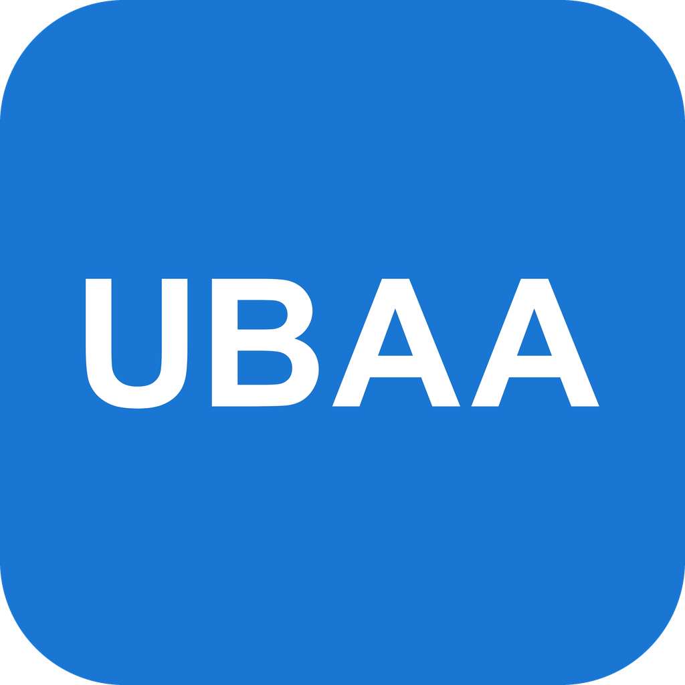

<div align="center">



# UBAA

**智慧北航 Remake：北航学生的一站式校园助手**

课表、作业、成绩、选课、预约、日程和云盘，一个应用全部搞定。

[](https://github.com/BUAASubnet/UBAA/releases)
[](https://github.com/BUAASubnet/UBAA/releases)
[](https://github.com/BUAASubnet/UBAA/stargazers)
[](LICENSE)


[**下载安装**](https://github.com/BUAASubnet/UBAA/releases) · [**使用指南**](https://ubaa.top) · [功能一览](#功能一览) · [常见问题](https://ubaa.top/tech/troubleshooting) · [问题反馈](https://github.com/BUAASubnet/UBAA/issues)

</div>

---

## 为什么选择 UBAA

- 📚 **一个入口**：不用在十几个学校系统之间来回切换，查课表、交作业前看截止、抢博雅、约座位都在同一个应用里。
- 📱 **全平台**：手机、平板、电脑都能用，覆盖 Android、iOS、HarmonyOS、Windows、macOS 和 Linux。
- 🌐 **校内校外都能连**：自动在直连和学校 WebVPN 之间选择，网络变化后自动恢复。
- 📴 **离线也能看**：打开就先显示上次的内容，没网时照样能看课表和成绩。
- 🔒 **数据留在本机**：所有校园请求都由你的设备直接发给学校，不经过第三方服务器；密码保存在系统安全存储里。

## 功能一览

| | 功能 | 你可以做什么 |
|---|---|---|
| 🗓️ | **日程与待办** | 课表、作业截止和自己的安排合在一条时间线里；支持重复规则、教学周、完成标记，可导出到系统日历 |
| 📖 | **学习** | 课表、考试、成绩、空教室、SPOC 和希冀作业、课堂签到、教学评教 |
| 🎓 | **博雅课程** | 浏览、筛选、选课与退选 |
| 🏛️ | **校园服务** | 图书馆座位、研讨室预约、阳光打卡、iHome 诉求、财务收入查询 |
| ☁️ | **北航云盘** | 浏览和管理文件，上传、下载、分享，回收站；也可用来在多台设备间同步日程 |
| ⌨️ | **桌面命令模式** | 在终端里查课表、看成绩、管理日程，和桌面应用共用同一个账号 |

每项功能的详细用法见[使用指南](https://ubaa.top/features/)。

## 快速开始

1. 在 [Releases](https://github.com/BUAASubnet/UBAA/releases) 下载对应平台的安装包。请认准 **v2.x** 版本。
2. 打开应用，用北航统一认证账号登录。连接方式选“自动”即可。
3. 登录后进入首页，所有功能都在底部导航（手机）或侧栏（电脑）里。

> [!TIP]
> 从旧版 v1.x 升级？请先阅读[新版变化与升级说明](https://ubaa.top/guide/ubaa2)。旧版的登录状态和设置不会自动迁移，需要重新登录。

桌面版附带 `ubaa` 命令，和图形界面共用账号与数据：

```bash
ubaa auth login --username 你的学号
ubaa schedule current
ubaa --json grades list --term 2025-2026-1
```

更多用法见[桌面命令模式](https://ubaa.top/features/command)。

## 隐私与安全

- 校园请求由设备直接发往学校系统或学校 WebVPN。
- 记住的密码保存在系统安全存储（如钥匙串）中，业务缓存加密保存。
- 匿名的产品改进统计在首次同意隐私政策后开启，随时可以在设置中关闭或删除已上传的数据。

完整说明见[隐私政策](https://ubaa.top/tech/privacy-policy)。发现安全问题请按[安全策略](SECURITY.md)私下报告。

## 技术栈

| 层 | 技术 |
|---|---|
| 校园协议与业务核心 | [](https://www.rust-lang.org) 认证、直连/WebVPN、解析、加密缓存 |
| 跨语言桥接 | [flutter_rust_bridge](https://github.com/fzyzcjy/flutter_rust_bridge) |
| 界面 | [](https://flutter.dev) [](https://dart.dev)，HarmonyOS 使用 OpenHarmony Flutter |
| 本地存储 | SQLite、系统安全存储 |
| 应用服务（更新与公告） | [](https://workers.cloudflare.com) D1、KV |
| 文档站 | [VitePress](https://vitepress.dev) |

## 参与开发

欢迎提交 Issue 和 Pull Request。日常开发在 `dev` 分支进行，`main` 是发布分支，旧版代码保存在 [`ubaa1`](https://github.com/BUAASubnet/UBAA/tree/ubaa1) 分支。

- [贡献指南](CONTRIBUTING.md)：从搭建环境到提交 PR 的完整流程
- [开发者文档](docs/README.md)：架构、合同、开发命令和运行手册

## Star History

<a href="https://star-history.com/#BUAASubnet/UBAA&Date">
  <picture>
    <source media="(prefers-color-scheme: dark)" srcset="https://api.star-history.com/svg?repos=BUAASubnet/UBAA&type=Date&theme=dark">
    
  </picture>
</a>

## 贡献者

<a href="https://github.com/BUAASubnet/UBAA/graphs/contributors">
  
</a>

## 致谢

UBAA 参考或使用了以下开源项目，感谢它们的作者：

- [fontlos/buaa-api](https://github.com/fontlos/buaa-api)：北航接口协议参考
- [CoolwindHF/Auto-BUAA-icw](https://github.com/CoolwindHF/Auto-BUAA-icw)：财务查询协议参考
- [sml2h3/ddddocr](https://github.com/sml2h3/ddddocr)：验证码识别模型

完整列表见[第三方声明](THIRD_PARTY_NOTICES.md)。

## 免责声明与许可

UBAA 由学生开发者制作和维护，是第三方工具，与北京航空航天大学官方无任何关系。课程、成绩和预约结果以学校系统为准。

本项目基于 [MIT 许可证](LICENSE) 开源。
