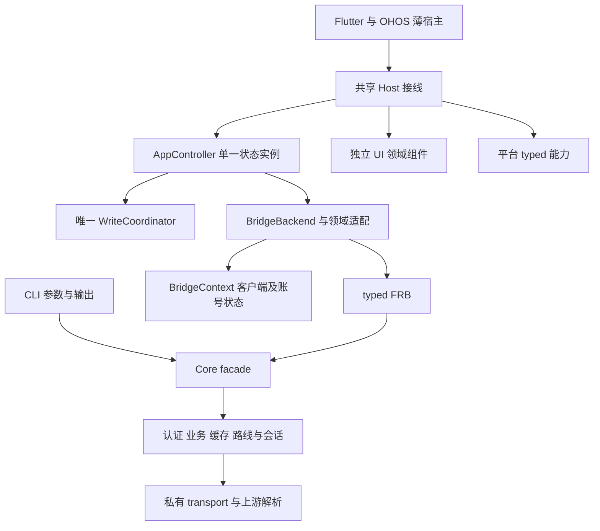

# 架构概览

Rust Core 负责协议、认证、路线、Cookie、会话、加密、解析、缓存与业务资格。CLI 和 FRB 生产调用只经 facade；Dart 与平台宿主不读取 upstream 内部状态，不拼接学校 URL 或处理原始响应。

UbaaClient 是普通聚合 facade。Direct/WebVPN runtime、配置 revision、网关探测和双路线协调在 Core 内；RouteClient 仅用于明确固定路线的诊断/测试。原始 HTTP transport 不自动跟随重定向，不拥有全局 Cookie，跳转规则由已验证业务协议决定。

CLI JSON schema v12 独立于磁盘 Session v2、配置 v1、缓存 schema v6。CLI envelope 的 schema v12 由序列化和 JSON Schema 合同共同验证，schema-v12 聚合输出覆盖成功、业务失败与参数错误。Flutter bridge contract v42 由 Rust 常量、Dart 接受版本与 codegen 零漂移检查共同约束。

AppController 的局部实现通过显式状态/操作合同协作，保持同一 ChangeNotifier 实例、账号代次和快照。BridgeContext 持有同一客户端，账号缓存与交互认证各有唯一状态对象。UI 消费不可变模型与回调；公开组件由显式 barrel 导出，局部 State 不越过组件边界供测试直接修改。详细路径见[现行代码组织](code-organization.md)。

写入资格与目标由 Core 的新鲜读取签发。App 的 WriteCoordinator 唯一拥有意图、准备、确认、取消、提交、失效与回读状态；宿主只注入能力，UI 不从中文文案或展示字段推断资格。非幂等最终提交至多一次，unknown 禁止自动重试；回读固定原路线且不能把未知结果升级为成功。完整问卷、Cookie、Token、验证码等材料不越过各自专属边界。

系统安全材料与加密缓存保留明确错误，不降级明文。业务协议与本地平台插件分别治理，本地 fork 的来源和退出条件见[适配清单](platform-adapters.md)。

实现、确定性测试、原生合成、Core-live、真实 App、设备和正式发布是独立证据。当前范围见 [goal.md](../../goal.md)，实际结果见[状态页](../migration/status.md)；历史说明见[归档](../migration/history/architecture-before-maintainability-2026-10-07.md)。
