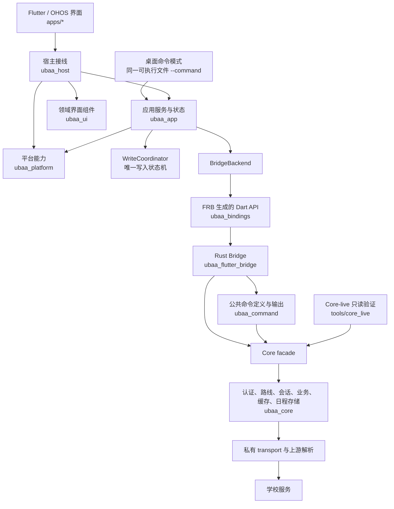

# 架构概览

本页是新贡献者的架构导读：用一张图说明 UBAA2 由哪些层组成、各层负责什么、一次读取和写入如何流转，以及读代码从哪里开始。陌生术语见[术语表](../development/glossary.md)，目录与模块细节见[代码与目录组织](code-organization.md)，Core 内部模块见 [Core 边界](core-boundaries.md)。

## 全局图

图中的规则：

- 所有生产调用都经过 Core facade。Dart 和平台宿主不读取 Core 内部状态，不拼接学校 URL，也不处理原始响应。
- GUI 和桌面命令模式复用同一套应用服务实现。每个进程持有自己的客户端与资源，通过共同的资料空间和持久状态协调账号与数据，设计见[桌面共享状态](../design/desktop-shared-state.md)。
- 应用服务（遥测、更新、公告）的 Cloudflare Worker 不在图中，它与学校服务无关，见[应用服务合同](../contracts/app-service.md)。

## 各层职责

| 层 | 位置 | 负责 | 不负责 |
|---|---|---|---|
| Core | `crates/ubaa_core` | 协议与业务规则、认证、Direct/WebVPN 路线与会话、Cookie、加密、解析、缓存、日程存储、账号访问校验和写请求的实际发送 | 进程输出、界面状态 |
| 公共命令 | `crates/ubaa_command` | 命令参数、执行、human/JSON 输出与退出码 | 协议细节 |
| Bridge | `crates/ubaa_flutter_bridge`、`packages/ubaa_bindings` | 把 facade 投影成稳定的 typed Dart API 和 Core 句柄；创建、替换和关闭时保持账号绑定与控制句柄一致 | 重定向、Cookie、加密、重试 |
| 应用服务与状态 | `packages/ubaa_app`、`packages/ubaa_domain` | 账号选择、会话恢复、读取调度、日程操作和用例编排；唯一的写入状态机 | 路线选择、上游字段推断 |
| 宿主与平台 | `apps/*`、`packages/ubaa_host`、`packages/ubaa_platform` | 入口、生命周期接线、安全存储、路径、文件与照片选择 | 业务状态机 |
| 界面 | `packages/ubaa_ui` | 用户输入、状态和结果呈现，消费不可变模型与回调 | 从文案推断写资格 |

客户端、账号绑定、取消和关闭控制由各自现有的资源所有者统一更新。替换 Core 客户端时必须同时处理关联状态，不能由多个互不知情的对象各自维护一份“当前客户端”。

## 一次读取如何流转

以打开成绩页为例：

1. **界面**：`ubaa_ui` 的成绩组件调用宿主注入的回调，自身不持有业务状态。
2. **应用层**：`AppController` 按读取组调度请求（同组串行，不同组可并行），记录发起时的账号和路线[代次](../development/glossary.md#代次)。
3. **Bridge 适配**：`BridgeBackend` 调用 `ubaa_bindings` 中 FRB 生成的 Dart 函数，跨 FFI 进入 Rust Bridge。
4. **facade**：Rust Bridge 调用 `UbaaClient` 的对应方法。Core 解析路线：Auto 时先探测是否在校园网，业务优先直连，域名出现网络失败时回退到 WebVPN。规则见[路由策略合同](../contracts/route-policy.md)。
5. **Core**：在选定路线的会话中发送请求、解析上游响应、读写加密缓存，返回 `{data, route}`，其中 `route` 记录实际使用的路线。
6. **返回**：Bridge 把结果映射成 typed DTO 或 typed 错误。应用层核对代次，丢弃账号或路线已变化的迟到结果，再更新快照；界面显示数据和本次实际路线。

离线时，应用层先展示 Core 加密缓存中的内容，再在后台刷新，规则见[离线缓存与恢复合同](../contracts/offline-cache-and-recovery.md)。

## 一次写入如何流转

写入资格与目标由 Core 在新鲜读取中签发，界面只依据 typed [操作资格](../development/glossary.md#操作资格与目标)开放入口：

1. **准备**：用户点击后，`WriteCoordinator` 发起 prepare，Core 复核资格与目标并返回一次性的写意图。
2. **确认**：界面展示确认信息，用户只能确认一次。
3. **提交**：Core 对非幂等请求至多发送一次。
4. **回读**：在原路线只读核对结果。结果不确定时返回 `outcome_unknown`，不自动重试，回读也不能把未知结果升级为成功。

日程中学校事项的本地完成、隐藏和备注只修改本机日程存储；学校业务写入仍经过 `WriteCoordinator` 和 Core 资格检查。

完整问卷、Cookie、Token、验证码等材料不越过各自的专属边界。宿主只注入写入能力，缺少能力时界面关闭写入口。写入合同见 [Flutter Bridge 合同](../contracts/flutter-bridge.md#6-写-intent)。

## 安全材料与平台插件

- 系统安全存储与加密缓存出错时返回明确错误，不降级为明文。
- 业务协议归 Core；本地平台插件分别治理，本地 fork 的来源和退出条件见[平台适配清单](platform-adapters.md)。
- 平台目标与工具链见 [Flutter 平台矩阵](flutter-platforms.md)。

## 从哪里开始读代码

| 想了解 | 先读 |
|---|---|
| App 如何启动 | `apps/ubaa_flutter/lib/main.dart`、`packages/ubaa_host/lib/src/ubaa_app_host.dart` |
| 桌面命令模式 | `apps/ubaa_flutter/lib/command_main.dart`、`crates/ubaa_command` |
| 应用状态与读取调度 | `packages/ubaa_app/lib/src/controller/app_controller.dart`、`controller/read_scheduler.dart` |
| Dart 如何调用 Rust | `packages/ubaa_app/lib/src/bridge/`、`crates/ubaa_flutter_bridge/src/api/` |
| 写入流程 | `packages/ubaa_app/lib/src/write/coordinator.dart`、`receipt_verifier.dart` |
| Core 入口 | `crates/ubaa_core/src/facade/client.rs`、`facade/routing.rs` |
| 某个业务的协议实现 | `crates/ubaa_core/src/features/<领域>/` |
| 界面组件 | `packages/ubaa_ui/lib/src/features/<领域>/` |

改动前先读对应领域的[合同](../contracts/)；认证、读取或写入改动还要遵守 [AGENTS 来源对照门禁](../../AGENTS.md#来源对照门禁)。

## 证据的独立性

实现、确定性测试、原生合成测试、Core-live、真实 App、设备和正式发布是相互独立的证据，一种通过不能代替另一种。当前结果见[状态页](../project/status.md)，旧版架构说明见[归档](../archive/history/architecture-before-maintainability-2026-10-07.md)。
