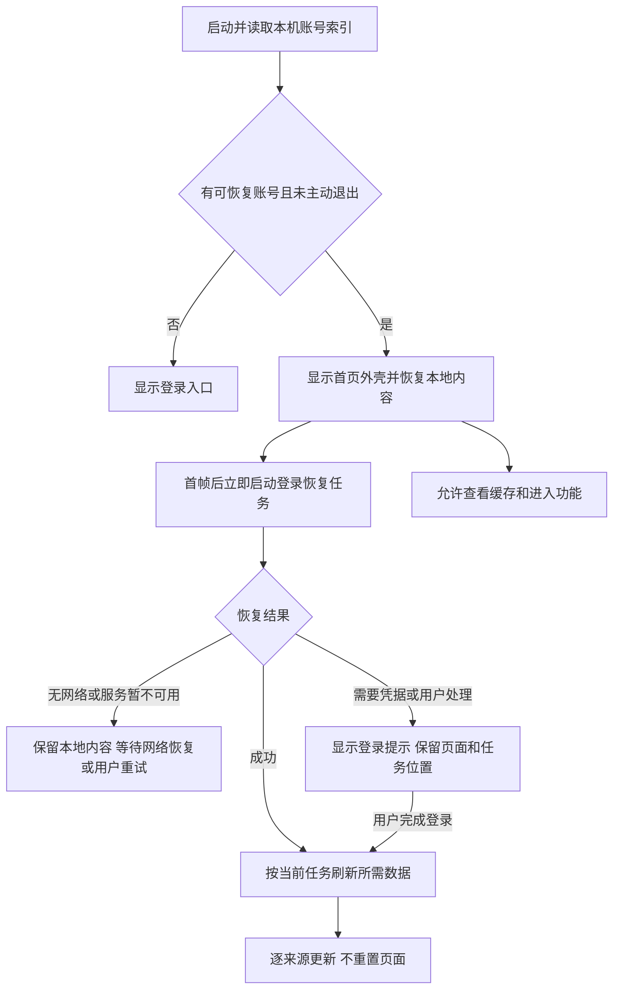

# 以学生使用场景为中心的离线首页、登录恢复与数据同步设计

日期：2026-09-17；历史状态更新：2026-09-23。本文保留当时已接受的设计与待验收目标，当前实现和验证边界见[迁移状态](../migration/status.md)，不从已替换的阶段目标推断结果或授权。

本轮用户明确调整启动要求：**进入本地首页后，立即开始恢复登录**。恢复任务不等待用户点击刷新、不等待进入某个功能，也不再以旧的自动登录开关作为是否启动任务的条件。

本方案覆盖启动、首页、十二个业务领域、账号生命周期、缓存与同步、写入前校验和多端验收。原设计轮仅交付文档；后续已通过独立活动合同授权实施，不恢复旧完整 UI/UX 合同中无关的暂停范围。方案中的时限和指标是待验收目标，不是已有性能证明。

## 一、产品目标与已确定的取舍

用户打开应用，通常希望马上得到一个答案，或者完成眼前的一件事。启动时应先满足这些任务，再更新不影响当前任务的内容。

确定以下行为：

1. 有可恢复本机账号时，先展示本地首页；首页首帧后立即启动一次登录恢复任务。
2. 阅读本地内容、恢复认证、刷新业务数据是三个独立状态；认证进度不会把已出现的页面换回全屏启动页。
3. 用户当前打开的页面和主动执行的任务优先；首页后台任务、历史补全和预取排在后面。
4. 缓存已成功取得的业务内容，支持再次查看；仅有限预取近期高价值数据，不启动全账号、全历史抓取。
5. 旧内容明确注明时间和来源；数据过期不会自动变成“无课程”“无待办”“已完成”。
6. 登录恢复成功只解锁继续查询的能力。签到、预约、取消、评教等仍重新获取资格并经过现有确认流程；不自动执行离线期间点击过的提交。
7. 保留旧版“首页／普通功能／高级功能”三入口、今日课表和待办主体、侧栏资料设置、顶栏单个路线图标及按需查询面板。
8. 缓存、认证和业务读取均按账号隔离；路线切换、账号切换、主动退出和迟到响应有明确处理。

## 二、当前事实与设计依据

以下来自本轮源码核对，不代表新方案已经实现：

| 当前事实 | 对设计的影响 |
|---|---|
| `AppController.initialize` 先读路线设置、认证状态和资料，再进入 home | 需要把本地展示入口与认证完成条件拆开 |
| Core `auth_status` 聚合校验 Direct/WebVPN；Bridge 读取持有共享客户端锁 | 调整 Dart 调用顺序不足以实现任务抢占，需设计有边界的调度与分段读取 |
| 上一轮已将默认预载从十二项缩减到五个首页来源 | 保留这一改进，不能因增加缓存同步又恢复全领域启动请求 |
| Judge 已有六个月早停、最多四个课程 worker、列表五分钟与详情两分钟的内存缓存 | 新工作重点是持久化、历史课程复查、选择性详情刷新和分段返回 |
| 当前 Judge 解析保留 HTML 链接顺序，作业开始时间需要从详情取得 | 无证据时不能根据一个旧作业推断剩余作业全部过期 |
| 当前 `FeatureSnapshot` 混合展示结果、读取状态与可操作信息 | 不直接将整个快照序列化后恢复为可写状态 |
| 宿主从后台恢复会重建 backend | 需要区分短暂切后台、网络变化、handle 真正失效，避免每次返回都冷启动 |
| 旧版已有课表本地化仓库和持久化历史课程集合 | 可复用其账号归属、完整导入后原子替换等依据，但新的全局自动缓存需单独设计 |

冻结引用已校验：`ubaa_old` 为 `1f4b8f8412272b6a423d4ad92b396e3db721e6f3`，`buaa-api` 为 `a63712fa2ae0a6c8066197063ddee98e3a6b5b81`。后者没有等价的 Judge 或全功能离线首页，不从相似接口推断协议。

关联资料：[旧版界面约束](ui-ux-old-baseline.md)、[既有操作清单](ui-ux-inventory.md)、[首页性能核对](../migration/source-parity-home-loading-2026-09-17.md)、[协议矩阵](../migration/source-parity.md)、[Core 边界](../architecture/core-boundaries.md)。旧设计材料中的历史提交和测试计数不覆盖当前冻结版本。

## 三、从用户要完成的事情确定优先级

下表是基于已有能力提出的使用场景假设，尚无用户访谈或行为统计证明各场景的实际频率。第一版采用清晰规则，不引入行为追踪或预测模型。

| 场景 | 用户打开后最想知道或完成什么 | 立即提供 | 后台优先做什么 |
|---|---|---|---|
| S01 赶去上课 | 下一节是什么、几点、在哪里 | 当日有效课表、当前／下一节定位、地点全文 | 更新今日课表，避免教室调整被旧数据遮蔽 |
| S02 教师通知签到 | 找到当前课堂并签到 | 缓存课堂入口、登录恢复状态 | 立即提高该课堂最新状态读取优先级，准备并确认签到 |
| S03 晚上安排作业 | 最近要交什么、是否交过 | SPOC／希冀已缓存待办，原截止时间和更新提示 | 临近截止、未完成、最近操作过的作业详情 |
| S04 收到出分消息 | 指定课程是否出分、分数多少 | 已缓存当前学期成绩、原有变化提醒入口 | 当前学期和用户打开的成绩结果，历史统计延后 |
| S05 找地方自习 | 某校区现在有空教室或座位吗 | 上次校区／日期／时间条件、静态楼馆信息 | 用户确认条件后查询当前资源；不将旧余量称为可用 |
| S06 准备使用研讨室 | 预约时间、地点、预约状态 | 已缓存的本人预约信息 | 即将开始的预约记录和详情，门锁状态按需在线查询 |
| S07 临近截止办事 | 博雅活动、阳光打卡、教学评教 | 原有相关待办、已知进度 | 用户点入的领域及其最新资格；其他领域延后 |
| S08 无网或校园系统故障 | 查课表、作业说明、考试安排、预约地点 | 已保存内容和清晰更新时间 | 网络恢复后自动启动一次恢复与刷新，不反复打断 |
| S09 切去其他 App 后返回 | 继续刚才的查询或表单 | 原页面、滚动位置、筛选草稿与安全表单草稿 | 合并必要的新鲜度检查，不重置导航 |
| S10 首次使用、换账号、主动退出后 | 明确登录对象并建立个人数据 | 正常登录入口，不出现他人缓存 | 登录成功后先建当前账号首页，再分批补充 |

任务优先级随显式操作立即改变。例如启动原计划更新作业，用户转去签到，就把签到相关读取提升；用户已进入成绩页，后台不得继续把历史作业置于它之前。

## 四、启动、恢复登录与生命周期

### 4.1 标准启动顺序



启动关键路径只包括轻量账号索引和当前首页的本地数据。先绘制可交互外壳；后台读取完整缓存索引、认证和预取都不阻塞首帧。若本地存储暂不可读，展示对应占位并继续恢复流程，不能以一次全库扫描阻塞应用。

“本地首页”是实现描述。用户界面仍叫“首页”；有缓存正在联网时显示“正在连接，先显示上次内容”，明确无网络时才称“离线”。

### 4.2 每次直接开始恢复登录

对可恢复账号，首帧后无条件创建或合并 `SessionRecovery` 任务：

1. 从现有安全路径恢复会话，复用仍有效的登录材料。
2. 会话失效时，立即使用可自动使用的安全凭据进入既有登录流程。
3. 成功后核对账号身份、路线和代次，开始当前任务所需的业务读取。
4. 凭据不存在、保险箱不可用、密码被拒绝或需要人工处理时，进入明确的“需要登录”状态；没有登录材料时不能制造恢复成功。

旧 `autoLogin` 不再作为启动恢复任务的开关。产品设置收敛为“在此设备保留登录”，说明其含义为保存允许的登录材料并在打开应用时恢复；首次登录时清楚呈现这一选项。关闭后，结束本次会话不再自动恢复账号。

旧配置迁移单独处理授权含义：已有自动登录授权和有效安全凭据的账号直接继承；旧版明确关闭自动登录的账号仍立即尝试恢复已有会话，其旧密码不因为升级就自动提交。需要重新输入时，在原首页提示完成一次登录并选择新的保留方式。这个兼容规则限制密码的自动使用，不限制恢复任务的立即启动，也不新增每次启动的确认弹窗。

认证流程使用现有协议，不引入隐藏验证码处理或无限重试。最终采用“当前任务所需路线先恢复”的调度：明确 Direct／WebVPN 时优先对应路线；Auto 由 Core 按现行规则决定，不由缓存图标或 UI 猜测网络。所需路线可用后即可服务当前任务，其他路线按需补齐，不要求两条路线都成功才允许查询。

当前 `auth_status` 只有完整双路线聚合返回，不能直接满足逐阶段就绪通知。P0 须定义新的恢复进度合同，P2 落实 facade／Bridge 分阶段恢复；保留现有 CLI 和双路线登录接口的原行为及各路线错误分类。不会让 UI 调用私有路线客户端，也不把一条路线成功显示成全部就绪。P1 可先用原聚合恢复完成本地首页收益，阶段验收明确尚未完成路线优先恢复。

### 4.3 恢复过程中的用户行为

| 用户动作／结果 | 界面与执行行为 |
|---|---|
| 只看课表、已缓存作业说明 | 可直接阅读，不弹登录阻断层 |
| 打开一个没有缓存的查询页 | 保留查询条件，显示“正在恢复登录，随后更新”；合并一个可取消的读请求 |
| 主动刷新 | 提升当前读取优先级；复用正在进行的登录恢复，不再启动第二次登录 |
| 点击签到、预约或取消 | 可进入目标详情或填写非敏感草稿；显示等待连接／登录状态，不提前生成写入意图 |
| 登录完成且用户仍在目标页 | 自动补读目标及资格，进入可准备状态；最终提交仍由用户确认 |
| 登录完成但用户已离开目标页 | 不弹确认、不执行写入；只更新合法缓存 |
| 登录失败 | 单条可操作提示“登录已失效，请重新登录”；保留当前页，可主动打开登录面板 |
| 网络失败 | “暂时无法更新，显示上次内容”；不将网络错误解释为密码失效 |

### 4.4 回到前台、重试与后台限制

- 短暂切到后台再回来，复用 controller、缓存与仍有效的 backend，不固定重建客户端。
- 每次回到前台调度一次合并的恢复检查；有进行中任务复用它，刚完成且会话仍有效的检查可快速完成。真正的 handle 失效才走重建。
- 明确网络恢复、用户刷新或新登录材料到达，可以唤醒等待任务。网络可达提示只是触发器，不证明学校服务或认证已成功。
- 暂时失败后的前台自动重试采用有上限退避，初始建议 30 秒、60 秒、5 分钟；不叠加 Core 已有内部重试。凭据错误和未支持交互不自动重试密码提交。
- App 进入后台后暂停非必要预取；已发送的学校写入遵守原状态机。移动系统挂起后不承诺持续后台登录、轮询或通知；本方案的“后台”主要指应用前台中的非阻塞任务。
- 主动退出先记录禁止自动恢复的本地状态并推进账号代次，再取消任务和处理原注销流程。重启也不得恢复这个账号的首页；重新显式登录后才重新开放其内容。

## 五、首页与主要任务流程

### 5.1 首页保持两部分，状态信息保持轻量

```text
菜单                    首页                  路线图标
正在连接 · 先显示上次内容                         （仅必要时）

今日课表                                      查看课表
  原有成绩变化提醒（若存在）
  当前／下一节课程：名称、时间、地点
  其他今日课程
  上次更新 08:10                                 （缓存时）

待办
  当前可关注的课堂签到
  即将开始的预约／活动、临近截止作业
  其他既有待办
  希冀正在更新，先显示已保存内容                    （局部状态）

             首页        普通功能        高级功能
```

不增加首页仪表盘、第四页签、常驻筛选栏或全领域同步面板。保留原卡片能力和默认时间顺序；通过当前／下一节提示与待办既有时间提高可扫读性。用户开始滚动、选择或编辑后，后台结果不突然将列表滚回顶部；新增导致排序大幅变化时提示“有更新”并在安全时机合并。

“待办为空”只有在所需来源全部成功、且当前时间投影确实为空时才能显示。缺少缓存、部分来源失败、未覆盖所有分页时分别显示“不完整”“暂未更新”“还有未读取内容”，不显示“全部完成”。

### 5.2 看课表：答案必须属于今天

1. 有当前日期或已完整保存当前周的数据，立即显示对应课程，标明更新时刻。
2. 昨天的今日接口快照不能换标题冒充今天。跨日优先从已验证的学期／周次日期范围投影；资料不足显示“今日课表尚未保存”。
3. 已有旧版完整学期导入模型可作为离线课表的独立能力：完整成功后原子发布；普通后台同步先保存当前周，完整学期补全在空闲时或用户明确操作时进行。
4. 在线成功后校正当天课程与地点，课表更新不得改变用户正在查看的其他学期或周次。

### 5.3 紧急签到：最短路径是恢复目标，不是重跑首页

从首页课堂入口直接进入对应课堂；立即提升该目标的读取优先级。缓存的“未签到”只能表示上次观察结果。认证就绪后重新读取目标和资格，沿当前 `WriteCoordinator` 的准备→确认→单次提交→回读完成。

如果等待期间签到结束，显示已结束并保留原因；如果已在别处签到，显示最新结果。不能因为用户先前点过一次按钮就在后台恢复后自动提交，也不能靠本地时间推导可写资格。

### 5.4 查作业与成绩：先读内容，再核实变化

- 作业列表先显示缓存摘要；打开已缓存详情直接可读，当前项的进度和成绩刷新提升优先级。
- 新增作业优先进入列表；可能被延期、改分或撤销的旧 ID 也需要重查，不能把 ID 不变理解为内容不变。
- 成绩页优先当前学期／用户指定学期。其他历史学期与全学年统计后补，完整度未齐时标注范围。
- 现有成绩变化通知只由同账号、同路线、同学期的两次有效在线观察产生；读取磁盘旧缓存不是一次“新出分”，不能触发重复通知。

### 5.5 找教室、预约座位与研讨室：恢复条件，实时确认资源

打开功能立即恢复上次筛选草稿和静态楼馆／站点。日期、时段或校区改变后使用新的查询键；昨天、其他校区或其他时段的结果不能占据本次结果位置。

资源快照可显示“上次查询”，但座位数量、空闲状态、时段、预约资格都要在线更新后才进入准备。图书馆日期和时段的关系继续遵守现有 typed 字段，不能因缓存便利臆造绑定。

本人预约可以离线查地点和时间；取消前核实最新订单和资格。门锁状态只保留现公开能力，离线显示“需联网核实”，不扩展为门锁密码缓存。

### 5.6 其他领域与资料

博雅已选、修读统计、阳光进度、历史记录和评教结果先展示已保存信息，状态、时间和当前账号清楚可见；相应写操作一律走实时校验。资料继续默认遮罩联系人。查询草稿可保存，照片、定位结果和未提交学校写操作不进入通用长期缓存。

手机保留单列和子页隐藏底栏；平板／桌面允许列表与详情并列，但只同步可见任务。窗口缩放、主题改变和键盘出现不触发重新认证或全量刷新。

## 六、统一数据状态与缓存策略

### 6.1 四种状态分别建模

| 维度 | 状态／元数据 | 用途 |
|---|---|---|
| 本地展示 | 无内容／本地内容／在线结果／部分结果 | 页面是否可读，不依赖认证完成 |
| 认证 | 恢复中／就绪／无网络／需登录／已主动退出 | 说明能否继续联网，不授予业务资格 |
| 同步 | 空闲／排队／读取中／完成／失败 | 局部进度、重试和去重 |
| 数据依据 | 账号、实际来源路线、查询、取得时间、覆盖范围、完整性 | 防串账号、串日期、串分页和将旧结果称为当前 |

另设写操作状态，继续由唯一 `WriteCoordinator` 管理。缓存恢复永远不会恢复一个有效写入意图或“本次已核实”的资格。

界面只显示对用户有帮助的信息：更新时间、正在更新、需要登录或本次范围不完整。缓存版本、队列优先级、锁和接口名称不进入正常页面。

### 6.2 全领域矩阵

以下刷新间隔为初始调度建议，用于抑制前台重复请求；到达间隔不意味着自动后台轮询。用户主动查询和写前验证可提升刷新优先级。接口参数、分页和错误合同不由这些时间改变。

| 内容 | 持久化与离线展示 | 自动刷新起点 | 操作约束 |
|---|---|---|---|
| 今日／周课表、学期与周次 | 保存精确学期、周和日期范围；已完整导入学期独立保留 | 今日可见且超过 10 分钟、跨日、用户进入目标周；稳定元数据按日检查 | 不用昨日快照推断今日无课 |
| 考试安排 | 按学期保存完整已取得集合 | 可见且超过 30 分钟；近期考试优先 | 未安排结果只在该次成功完整查询范围成立 |
| 成绩及统计 | 按学期缓存，保留必要历史 | 当前学期可见超过 5 分钟；历史打开时超过一天再校验 | 分数变化必须来自新在线结果，统计显示覆盖学期 |
| SPOC 作业与详情 | 列表／详情分别保存，独立完整度 | 活跃列表约 5 分钟；可见或临近截止详情约 2 分钟 | 不从缓存推断提交成功 |
| 希冀作业与详情 | 课程索引、作业索引、摘要、详情和历史检查元数据分别保存 | 见第八节；活跃项优先，历史项低频 | 未证实顺序时不执行“首个旧项即全课程永久跳过” |
| 今日课堂签到 | 按日期保存上次观察的课堂信息 | 今日页可见每次进入优先校验；同次重复请求合并 | 操作前重新读资格，跨日失效；不作为到课凭证 |
| 博雅 | 列表按完整查询保存，已选／统计／资料独立 | 已选首页约 5 分钟；可选页面进入时更新 | 余量、选退课、签到签退在线核实 |
| 空教室 | 缓存楼宇信息及精确日期／节次查询 | 用户进入／应用条件后更新；同条件短时约 1 分钟去重 | 缓存仅上次结果，无永久“空闲”标记 |
| 图书馆 | 楼馆／分区元数据按日；保存已查询时段、座位与本人预约 | 可见座位约 30 秒视为需刷新；本人预约进入时更新 | 写前必查；查询完整度、日期／时段关系不猜测 |
| 研讨室 | 站点／用途元数据按日；已查日期空间和本人订单分开保存 | 当前时段约 30 秒视为需刷新；临近预约订单优先 | 门锁状态、预约／取消资格必须在线核实 |
| 阳光打卡 | 按学期／周保存概览，记录按分页存储 | 首页相关提醒约 5 分钟；进入记录页或提交后立即更新 | 本地达标记忆与真实提交结果分离，不长期保存照片／位置 |
| 教学评教 | 按当前上下文保存列表与进度 | 进入页面且超过 5 分钟，提交后立即更新 | 离线不提交，确认前重新读取目标和资格 |
| 资料、设置、静态资源 | 本地偏好立即可用；资料最小化存储并遮罩 | 认证成功后更新资料；资源独立版本管理 | 敏感登录材料仅走原安全存储 |

“所有功能支持缓存”指其可展示的合法业务结果支持保存与再次查看。未访问的历史页、所有座位组合、图片附件和无限分页不默认全部下载；用户可显式查看历史或保存支持的学期课表。

### 6.3 刷新失败、空结果与分页

1. 成功且完整的新查询可以原子替换对应范围；明确成功的空结果也是合法新版本。
2. 超时、鉴权失败、解析失败、分页中断和未知完整度不能把已有成功集合替换为空。
3. 部分查询逐页记录自己的范围和代次；不能把第一页缺少某项解释成该项被删除，也不能把新第一页与旧第二页拼成“完整的新列表”。
4. 对不保证稳定分页的上游，缺失条目标为待核实；仅完整一致遍历或单项权威结果可确认删除。
5. 后台结果按账号代次、查询键和请求修订校验；同查询较旧响应不能覆盖较新结果。网络迟到的旧账号结果不得写入新账号磁盘区。
6. 失败只更新 `lastAttempt` 与同步错误，不刷新 `fetchedAt`，不能把昨天的数据标成“刚刚更新”。

### 6.4 存储、保留与清理

由一个统一业务数据仓库负责持久化，不为每个功能分别创建散落的 JSON 缓存。首选可事务化的嵌入式存储；具体 SQLite 绑定和加密方案在六平台原型验证后锁定，设计阶段不假定新增依赖已兼容 OHOS。

记录键包含：不暴露账号正文的内部账号标识、实际数据来源路线、功能／操作、规范化查询参数和数据版本。保存 `fetchedAt`、`lastAttemptAt`、`lastVerifiedAt`、完整性／覆盖范围与请求修订；UTC 存储时间、校园日期按已有规则解释。机器时钟倒退时降低新鲜度可信度并请求校验，不让数据永远新鲜。

业务内容使用独立版本的缓存数据库，不写入 `session.json`、Cookie 文件、凭据保险箱或诊断记录。私有目录、文件访问边界和平台安全密钥继续适用；需要保护的个人内容加密保存，密钥不可用时只显示外壳和恢复提示，不退化到明文存储。

初始容量建议每账号软上限 50 MB、硬上限 100 MB，仅业务文本与结构化数据。优先保留当前学期课表、当前考试、活跃待办和即将使用的订单；先淘汰较久未读的详情、过期资源查询与旧分页。图片／地图工程资源另计。用量在设置提供“清理缓存”；实际阈值以设备测试调整。

稳定学业历史可在容量内保留；已结束待办／订单优先保留近 90 天，再按访问情况淘汰。过期的签到／座位状态不作为当前首页内容；保留展示价值和可写资格的时效分别管理。

主动退出关闭账号可见入口与自动恢复；“退出并清除本机账号”清除业务缓存、账号索引、凭据、成绩基线和提醒偏好，取消未发送任务，并阻止迟到回调重建缓存。仅清理缓存不等于退出登录。删除失败明确反馈，不能显示清理成功。

## 七、围绕用户任务的后台调度

| 优先级 | 任务 | 调度原则 |
|---|---|---|
| P0 | 用户操作必需的认证、写前目标／资格读取、既定写后回读 | 高于普通同步；单次写流程的路线与顺序保持原样 |
| P1 | 当前可见查询、用户刷新、刚点开的未缓存详情 | 同账号同查询合并，后台队列中同任务直接提升 |
| P2 | 今日课表、当前课堂、临近预约和截止任务、首页其他来源 | 根据缓存是否缺失、是否临近事件和更新时间排序；完成一项显示一项 |
| P3 | 历史详情、其他学期统计、有限预取、历史课程复查 | 前台空闲才开始，可暂停，不阻塞 P0／P1 |

同键只保留一个在途读取；不同任务可共享同一学期、课程索引等前置结果。显式“完整刷新”绕过新鲜度跳过规则，但仍合并在途任务并遵守接口限制。后台刷新不会修改用户草稿、打开其他页面或更换其已选学期。

**必须处理底层锁，不能只给 Dart Future 排优先级。** 当前一次 Judge 聚合读取可长时间持有 Bridge 客户端锁。计划把大聚合划分为可调度批次，在 Core 允许的稳定边界返回批次结果和后续进度；批次内部仍保持会话、worker 隔离和错误仲裁，结束后才让更高优先级任务运行。不得简单释放锁同时共享可变 Cookie，也不得靠打开多个持久会话客户端绕过锁。

任务切换只抢占尚未发送的批次；已在网络中的请求按原超时／取消合同收尾。未确认取消成功时不能认为它已释放资源。对分段仍需长时间等待的单个请求，应显示具体局部状态，不承诺学校网络能在固定秒数完成。

认证与写事务设独立生命周期栅栏。账号／路线变化时停止旧队列的后续批次，已发送请求的结果重新检查代次。写入进行中不允许后台重认证或 backend 重建破坏其既定状态；待它到达安全终态后再恢复。

## 八、希冀专项：持久化与选择性刷新

### 8.1 保存内容

按账号、路线、课程 ID、作业 ID 保存已验证索引、必要摘要、详情、最后校验时间和查询完整度。列表指纹可判断新增／移除链接，但不能证明详情未变化。课程进入低频状态时记录判断依据和下次检查时间，不能只有永不过期的黑名单。

### 8.2 一次刷新

1. 立即展示已保存摘要；缺少详情的项目可显示标题和“详情待更新”，不编造截止时间、分数或提交状态。
2. 读取课程与作业索引；优先可见课程及有活跃待办的课程，创建新增项／需复查项集合。
3. 优先读取新 ID、当前详情、未完成／临近截止项、近期可能更新成绩的项目。
4. 其余稳定历史详情复用缓存，在空闲批次或用户打开时校验。关闭页面后暂停剩余低优先级批次。
5. 每个合法批次发布结果与完整度；首批作业无需等所有课程结束才能出现。单课程失败保留其旧内容并说明，整体认证／会话冲突仍终止相关批次。
6. 定期完整校对索引和低频详情，显式“包含历史”“完整刷新”可绕过历史跳过策略。

这属于客户端选择性刷新。没有已验证的上游增量游标、修改时间或 ETag 合同时，不新增这类参数，也不宣称具备严格的服务端增量同步。

第一次建立缓存时仍可能需要较多详情请求，不能承诺冷数据的完整结果瞬间出现。第一阶段依靠渐进返回与让位保持可用，后续启动和重复访问才获得持久化及选择性刷新带来的请求削减。

### 8.3 六个月规则的修正条件

当前代码按作业开始时间判断六个月边界，沿页面顺序遇旧作业就退出该课程，并在当前运行时将课程记作历史。

新方案把六个月作为降低后台刷新频率的依据。只有真实证据和测试证明返回列表具有所需单调时间顺序，才允许“首次越界即不再读后续详情”；否则必须使用已知索引／摘要逐项筛选，未知时间项目保留待核实状态。

不能只因为课程含一个旧作业就永久排除整个课程。旧课程列表初始建议一天检查一次；发现新增 ID、已知待办仍有效、用户主动打开或完整刷新时立即激活。历史详情初始建议七天抽取到期批次校验，打开详情则提升优先级。开始很早但截止尚未到、状态不明或近期重新开放的作业，不能仅凭开始时间被隐藏；有据可查的长期作业继续保留。

新增这一策略必须记录与冻结旧版早停规则的明确差异，并覆盖“旧项后还有新项”“六个月前开始但尚未截止”“旧课程新增作业”“日期不可解析”等脱敏测试，不能直接静默替换协议矩阵中的缓存语义。

## 九、架构职责与合同变化

| 层 | 负责 | 不承担 |
|---|---|---|
| Core 领域与缓存仓库 | typed 业务缓存、覆盖范围、原子替换、选择性刷新策略、读后失效、账号／路线归属 | Flutter 布局、页面跳转、推导用户点击 |
| Core facade | 明确的缓存读取出口、在线读取／分段进度、稳定错误和来源元数据 | 暴露 upstream、Cookie 或私有 runtime 给宿主 |
| Bridge | 传递 typed 缓存结果、同步进度与任务命令，保持生命周期边界 | 自建第二套缓存规则或自行拼请求 |
| `ubaa_domain` | 展示数据依据、认证／同步状态、不可写的缓存投影类型 | 访问数据库、凭据或上游 |
| `ubaa_app` | 本地首页启动、恢复任务、可见任务优先级、去重、代次、页面数据订阅 | 将缓存认作登录成功／写入授权 |
| `ubaa_host`／`ubaa_platform` | 安全凭据／密钥、私有目录、前后台与网络事件、平台适配 | 直接读取 session 内部或复制学校响应 |
| `ubaa_ui` | 缓存／更新状态、稳定列表、任务入口、草稿与返回位置 | 直接登录、操作缓存文件或创建有效写入资格 |

只有 Core 业务仓库持久化业务内容；App 持有内存投影，平台保留最小账号索引与本地偏好，避免三层各存一份内容。

建议的概念出口为 `read_cached_home`、`read_cached_feature`、`refresh_scope` 与受控的 `ReadProgress`；名称和字段在合同阶段确定，本轮没有新增 API。缓存读取不依赖成功认证，也不能等待网络读取持有的客户端锁；应使用独立、本地、短事务的存储访问路径。

缓存响应必须区分完整／部分、磁盘／网络来源和实际来源路线。缓存类型不包含 `WriteIntent`、opaque handle、照片字节、登录材料或可直接复用的 action。恢复到 UI 的稳定业务 ID 只能用于重新查询目标。

缓存数据库独立 version。新增 Bridge DTO／流式进度或公开 facade 行为时同步更新合同版本、生成绑定和对应宿主；CLI schema、Session v2 和配置版本只有发生对应兼容性变化时才调整，禁止借缓存计划静默改动现有语义。

## 十、错误、身份与操作一致性

| 情况 | 必须呈现／保证的行为 |
|---|---|
| 首次启动无账号无数据 | 登录入口；不展示演示个人数据 |
| 已有账号但尚未缓存今日内容 | 首页仍可进入，今日区明确未保存；立即恢复登录后补读 |
| 缓存损坏或版本无法迁移 | 隔离受影响范围并重建，其他范围继续可读；不循环崩溃 |
| 磁盘满、写缓存失败 | 已取得的在线结果仍可显示；同步与保存状态分开，不称已可离线使用 |
| 保险箱或密钥暂不可用 | 不降级明文；明确需要解锁／重新登录，保留非敏感外壳 |
| 认证结果对应另一个账号 | 停止投影与同步，清空当前可见个人内容并转账号处理；绝不绑定到旧缓存 |
| 路线切换 | 旧内容注明原来源，不冒充新路线读取；失效旧任务和写意图，按新策略恢复 |
| 多路线／多来源混合首页 | 顶栏仍单个图标；离线样式表示历史来源，展开列出各来源及时间 |
| 一个子系统失败 | 局部提示，不清空全部首页，不把所有失败都归为主账号掉线 |
| 成功写入后刷新失败 | 已确认结果与旧快照分开展示；目标标为待核实，优先回读，不显示旧资格可继续操作 |
| 写入结果未知 | 保留“结果待核实”，禁止自动再次提交；重启后仅可恢复最小核对线索，不恢复有效意图 |
| 离线时用户想提交 | 保存允许的本地草稿，提示联网后继续；不建自动提交队列 |

写后失效按目标影响范围执行：签到更新当天课堂／首页待办；博雅选退课更新已选、详情及相关统计；图书馆／研讨室更新订单与对应资源查询；阳光更新概览及记录；评教更新目标课程和进度。不能每次写后清空全库，也不能仅更新当前卡片留下另一入口的旧动作。

所有日志和性能诊断只记录操作枚举、耗时、命中／失败类别、数量和覆盖状态，不记录账号、课程正文、查询敏感值、原始响应或凭据。沿现有 LocalDiagnostics 白名单，不新增自动上传。

## 十一、性能目标与验收方法

以下是建议验收门槛，须在明确的手机、平板、macOS 与发布模式候选上实测后确认，不从 Debug 的单次观察推算。

| 指标 | 首轮目标／验收条件 |
|---|---|
| 有合法本地缓存的启动 | 从进程启动到可操作首页，目标中位数 ≤ 500 ms、P95 ≤ 1 s；逐设备单列结果 |
| 网络依赖 | 断网及登录请求挂起时，缓存首屏都可出现；网络不在本地内容关键路径 |
| 恢复任务启动 | 首页首帧后 200 ms 内已创建或合并恢复任务；不把此指标当作网络认证完成时限 |
| 已缓存页面重入 | 目标 P95 ≤ 200 ms，且重复进入不重复请求同键在途操作 |
| 紧急任务调度 | 下一可用安全批次优先运行 P0／P1，不继续发送排在其前面的历史批次 |
| 希冀渐进结果 | 第一课程／批次完成即可呈现，展示其余范围仍在更新；分别测首批和完整完成时间 |
| 内容稳定性 | 刷新不清屏、不滚回顶部、不关闭草稿；旧结果不覆盖新结果 |
| 数据正确性 | 无跨账号／日期／学期／路线误标；部分失败不清空集合；离线不能提交 |
| 请求成本 | 记录同样合成数据下冷启动、热启动、五分钟后和重启后的请求数／缓存命中，证明减少了重复读取 |

每设备至少 30 次有缓存启动，区分进程冷启动与返回前台；固定数据规模、构建模式及磁盘条件，另测无网、慢网和大缓存。首次安装／首次登录另列，不混入有缓存启动统计。真实网络记录首次内容与全部完成时间，不承诺所有校园接口在固定秒数返回。

必须覆盖以下验收场景：

1. 飞行模式打开，能读已缓存课表／作业／订单，主动联网后原位更新。
2. 登录恢复延迟／失败时页面可操作，重试复用同一任务。
3. 自动恢复在首页首帧后启动，不依赖旧 `autoLogin` 启动条件；无可用材料清楚进入需登录状态。
4. 正在后台读取希冀时进入签到，后续批次让位；最终确认前不会发送学校写操作。
5. 今日跨日、跨周、跨学期及假期，旧数据不冒充当天结果或“今天无课”。
6. 同一作业 ID 延期、改分、状态更新，以及旧课程新增作业都可发现。
7. 早停顺序不成立、长周期作业与未知日期，不漏掉应保留内容。
8. 网络失败与真正空列表、部分分页与完整集合、移除与暂未读取有区别。
9. 多次刷新、返回重进、前后台切换不会制造登录风暴或同键重复读取。
10. 账号切换、主动退出、退出并清除后，旧回调不能回写；重启不重新打开已退出账号。
11. 缓存恢复不复活签到／预约／取消／评教资格和过期写意图。
12. 写成功但回读失败、结果未知及重启后的核对，不自动重发、不假成功。
13. 路线变化后历史来源与当前认证路线分开呈现，已绑定的写流程不透明换路。
14. 缓存损坏、版本升级、容量淘汰、磁盘满、密钥不可用有明确退路。
15. 手机／平板／桌面不同宽度、主题、文字放大、表单和返回位置均保持。

确定性测试、原生合成渲染、Core-live、真实 App 只读与正式发布分开记账。实现时新增行为先 RED，再最小实现和聚焦 GREEN；完成相应门禁及双路线真实只读。真实业务写入通过脱敏 backend 验证，不把计划或缓存成功当成学校业务成功。

## 十二、实施阶段与交付边界

| 阶段 | 具体交付 | 完成条件 |
|---|---|---|
| P0 合同与来源 | 精确逐操作对照、缓存响应／身份／完整度模型、登录选项迁移、存储／分段读取／分阶段认证原型 | 冻结差异和未知项明确；跨平台存储／密钥可行；新公开合同及版本决策完成 |
| P1 本地首页与立即恢复 | 当日课表和已有待办最小缓存、独立展示／认证状态、首帧后恢复登录、离线提示 | 有缓存无网可进；需登录不踢回启动页；首次登录／主动退出／账号隔离通过 |
| P2 任务调度与操作保护 | 优先队列、去重、前后台生命周期、所需路线先恢复、Bridge/Core 可让位批次、写前读取与失效 | 当前路线就绪可先服务任务；长任务在下一安全边界让位；恢复后不自动提交；回读保护通过 |
| P3 希冀选择性刷新 | 索引／详情持久化、渐进返回、历史课程复查、完整刷新入口 | 重启复用缓存；旧课新增／同 ID 变化／早停边界与部分失败测试通过 |
| P4 全领域接入 | 按第六节矩阵接入所有查询／详情，完善课表离线覆盖与缓存清理 | 既有操作清单逐项映射；全部既有功能仍可达，无原始响应或写资格落盘 |
| P5 多端与性能验收 | 最终候选的回归、各设备启动统计、双路线生产只读、容量／升级／故障测试 | 分项达到目标或明确差距；保留证据类别，更新正式合同和当前产品说明 |

建议先交付 P1 的可见收益，再完成 P2／P3 解决长查询对操作的影响；P4 提供全功能一致体验。不能只做“隐藏加载动画”的首页改动就宣布离线方案完成。

原设计轮产出为本方案及状态／决策索引。当时实施目标见[离线阶段快照](../migration/history/goal-2026-10-01-before-consolidation.md)，按该目标逐阶段提交；旧完整 UI/UX 暂停合同已归档，主工作区及其既有改动继续保留。本文“当前事实”与原型建议保留设计时点含义，当前实现与分列验收结果见[迁移状态](../migration/status.md)，长期规则以 [AGENTS](../../AGENTS.md)为准。
