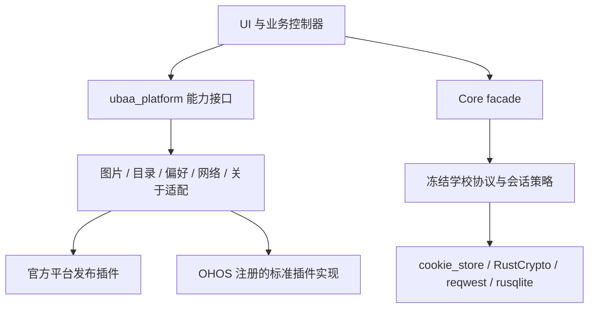

# 通用依赖收敛实施与扩展约定

日期：2026-10-07。分支：ubaa2。审计基线 2eae5549，Core 阶段提交 f73fafc9。实施前来源与九列裁决见 [source-parity-dependency-reuse.md](source-parity-dependency-reuse.md)，问题清单见 [审计](dependency-reuse-audit-2026-10-07.md)。用户已授权落地，不考虑旧数据迁移。

## 最终结构

横向增加平台时，优先在宿主依赖表注册对应 federated 插件；标准 API 以外的平台差异集中在适配层，业务不增加 operatingSystem 判断。纵向增加功能时，业务先定义需要的能力与数据合同，通过注入端口组合，不能在页面里另建系统通道、HTTP 会话、文件数据库或密码存储。

## 已收敛能力

| 能力 | 实施 | 保留的项目责任 |
|---|---|---|
| Cookie | cookie_store 0.22.1 的 Cookie、CookieDomain、CookiePath 替代解析/匹配；修复 Max-Age 优先与空 Domain | StoredCookie 持久格式、注入时钟和相对期限小适配、双路线/CAS/代次；未开启全局 Jar 或额外 PSL 策略 |
| 协议加密 | cbc 0.1.2、cfb-mode 0.8.2、ecb 0.1.2、cipher 填充、hex | 学校密钥/IV、字段序列化、编码；SPOC 整块不额外填零，CFB 部分块保持等价 |
| 照片 | image_picker 1.2.4；三个桌面共用 file_selector；删 Android/iOS/macOS/OHOS 自写选图通道、Apple PhotoPayload | 内存 10 MiB 流式限制、图片解码元信息验证、文件名/MIME、权限错误、取消/并发、临时文件清理 |
| 目录 | path_provider 2.1.6，绝对 UBAA_CONFIG_DIR 可覆盖；删桌面 HOME/XDG/APPDATA 拼接 | Android 仅保留 PrivatePaths 获取 noBackupFilesDir；其他系统使用插件 Application Support；初始化前不能猜目录 |
| 普通偏好 | shared_preferences 2.5.6；官方端 Async，OHOS 直接用标准 StorePlatform，无旧门面缓存；删两套 JSON/临时文件/chmod | AccountPreferences 集中作用域哈希、顺序和 codec；按账号独立键；损坏数据拒绝普通保存覆盖；不存密码/Cookie/成绩 |
| 网络信号 | connectivity_plus 6.1.5 的系统事件；Host 仅保留原导入入口的转出 | 重订阅/迟到查询代次、首次基线、去重；只提示恢复，不判断学校可达性/登录；业务退避仍在控制器 |
| 关于页 | 官方 package_info_plus/url_launcher，OHOS 注册标准实现；删 AboutChannel | AppLink 白名单、版本显示和固定错误；外链不经过学校客户端 |
| 成绩旧文件 | 删除 FileGradeScoreStore 和 Host/Controller 的迁移、清理链 | 新观察只交 Core 加密仓库；旧文件不读、不改、不删除；已有公共 Bridge 可选 legacy 字段保持，生产不再传值 |

拍照差异明确化：Android 仍提供原有拍照入口，使用插件相机流程生成最多 320×320、质量 92 的预览用途图片；旧版系统 TakePicturePreview 的尺寸由设备决定，因此不宣称字节或尺寸完全一致。iOS/OHOS 不因接入插件而增加原本没有的拍照按钮。跨进程遗失结果没有可信的原表单/账号，启动时只清理可识别的临时副本，不自动附给新账号。删除只限应用临时目录内已解析真实路径的文件，外部原文件保持只读。

普通偏好以配置目录作用域和账号的 SHA-256 组合键隔离；哈希用于避免键暴露标识，不视为加密。所有偏好操作在同 isolate 共享顺序，避免桌面文件后端并发读改写；不是跨进程事务。插件成功不等同于关键数据持久性保证，敏感材料仍归安全存储，业务内容仍归 Core。

## OHOS 依赖与维护面

- 图片、目录、偏好、外链最终固定 CPF-Flutter/flutter_packages 提交 `2f21e26e09efb92b8429c840ae7ca0cb024f036c` 的四个 OHOS 子包；只在 OHOS 宿主声明，不 override 官方五端依赖。
- 初始 SIG 候选 `35fb4675` 已能构建，但源码复核发现偏好实现有异步 put/flush 顺序及失败 Promise 问题。最终采用上述 CPF 提交，其中 put/remove/初始化已同步完成再返回；不将构建成功当成选择该旧候选的理由。
- 网络和包信息上游门面仍是旧主版本：只提取 CPF-Flutter/flutter_plus_plugins 提交 `9571de239933ab2893dbd49037e128135b050a7c` 的 OHOS 原生实现，分别放在 connectivity_plus_ohos / package_info_plus_ohos，保留许可证、原文件 SHA 与差异说明。没有复制其他平台或旧 Dart 门面。
- 网络补丁只适配标准列表结果、失败传播和每次订阅独立生命周期；迟到回调不能发布到新订阅。包信息继续标准 getAll 通道。原生日志在这两个本地分发包中移除。
- 安全存储沿上一阶段的 HUKS 分支。本地分发包仍是维护责任，不声称所有 OHOS 实现都已完全交由上游维护。后续优先跟进满足当前 interface 和合同的独立社区发布版，再移除本地分发。
- OHOS 偏好插件不支持 Async 新接口，因此兼容只集中在 PluginPreferenceValues；能力消费者及业务 codec 不区分平台。只使用 getAll 的精确 allowList、String setValue 和单键 remove，不使用全库 clear。

## 扩展与升级检查点

1. 新能力先查 Flutter/生态插件及其目标平台实现；接口以业务需要的最小值/错误为边界，原始路径、原生异常、凭据不进入 UI。
2. 引入依赖同时固定锁文件和 OHOS 提交，检查系统最低版本、Flutter/Dart/Gradle/Xcode 与许可。插件回调生命周期、权限、取消和异步失败须有合同测试。
3. 插件负责系统机制；业务负责账号/路线/查询代次、一次性写入、取消及缓存策略。禁止为少写适配而绕过 facade 或混用第二套学校客户端。
4. 对原生缺口先扩展注册实现，保留必要的薄适配（例如 noBackupFilesDir）；不要在每个平台 Host 复制同一个通用功能。
5. 上游修订集中包边界，记录原因和撤销条件；不直接修改全局 pub cache 来“修好”构建。无需旧数据兼容时移除旧运行链，不删除用户旧材料。

## 验证记录

- Core：Cookie 两项行为 RED→GREEN，333 项 Core 单测、完整 just check、CLI E2E/Bridge/编译边界通过；主锁文件和编译夹具锁文件同步。
- Flutter：7 包 format/analyze/test 通过，合计 1323 项（57/82/636/350/31/92/75）。数量变化主要来自删除已消失通道/旧迁移的测试，并补插件边界、同账号顺序、损坏偏好、媒体校验/取消/拒绝与网络订阅回归。
- 旧成绩回归：损坏旧文件在删除迁移前阻塞基线（RED），删除后新基线/清理成功，旧文件逐字节不变；迟到批次不能恢复被清理内容。
- macOS Release 构建通过；真实插件目录及偏好写/读/重开/删除集成 1 项通过。测试 runner 曾报告无法自动置前，不将其当作 UI 截图验收。
- Android Debug APK 构建通过；独立模拟器真实插件目录（无 HOME/noBackup）与偏好生命周期 1 项通过。
- iOS Simulator 无签名 Debug 构建通过；没有把构建当成设备操作验收。
- OHOS：网络原生源码合同在旧上游先失败（标量结果），适配后列表/错误/取消/重订阅及迟到回调通过；安全存储原生合成合同保持通过。最终 CPF 固定依赖下的无签名 Debug HAP 与 arm64 Rust 动态库门禁通过，OHOS 宿主分析及 2 项测试通过；未连接 OHOS 设备，不声称设备/签名验收。
- 真实学校：本轮 `just verify-live mode=webvpn` 退出 0，40 个只读操作记录 PASS；其中空数据只证明该读取成功，不证明写资格或内容覆盖。未执行学校业务写入。Direct 按活动合同不运行。
- 新增 OHOS 偏好适配单测 1 项通过，验证精确 allowList、跨实例无缓存、失败回执传播与单键删除；独立于设备验收。
- 提交前最终 just check、refs、layout-check、check-sensitive 与暂存区 diff 检查通过；OHOS 构建生成的本机 SDK 锁路径和 buildinfo 副作用已恢复，运行材料未入库。
- 原生日志、RED 记录、构建及 live 输出存于仓库外私有目录 `~/Library/Application Support/UBAA-private-evidence/dependency-reuse-20261007/`；本文件只保留摘要。

定位仍明确不可用；桌面组件和 multipart 按审计保留必要业务实现，未因为本轮引入新的后台定位、通知或数据库。Windows/Linux 使用注册插件和共享测试，但本机没有对应系统运行证据。
