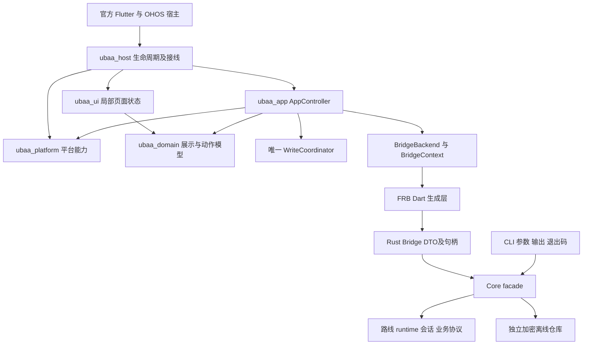

# UBAA2 工程质量、可维护性与技术债独立审查

日期：2026-10-07（Asia/Shanghai）。审查基线：`06e4dfdb91303d1d723cbf570bd0fc49b55bf73e`，分支 `ubaa2`。本报告独立于同日的 [F1—F7 审查](maintainability-audit-2026-10-07.md)及[实施记录](maintainability-implementation-2026-10-07.md)，不覆盖它们，不把历史通过当作本轮证据。

## 1. 总体判断

项目已具备可持续维护的基础：协议集中于 Core，宿主边界明确，写入意图只有一个应用层协调器，离线内容不恢复写资格，依赖、生成和平台工具链有锁定入口。上一轮 UI 与 Bridge 拆分有实际效果，独立 library、显式参数和包出口让功能定位更直接。不能据此认为跨阶段状态已经安全，也没有理由全仓换框架或继续机械拆文件。

**当前最值得投入的是补齐跨阶段不变量及门禁的反例，而非再调整目录。** 本轮用当前生产模块和纯合成输入复现了确认路线漂移、登录终态卡住、退出后旧路线快照写回及损坏偏好无法清除；同时确认敏感扫描、源码依赖检查和发布材料存在验证能力缺口。相关现有测试仍通过，说明问题集中在测试没有跨过的异步/工具边界。没有执行真实账号读取或写入，未证明发生过真实敏感信息泄漏、跨账号写入或重复提交。

下一位开发者最容易遇到的成本：

- **引入错误**：照抄一个普通写入口，以为 Bridge 已校验路线就等于最终发送已绑定路线；或在 `await` 后调用会直接改全局状态的 helper，再检查代次。
- **迷路**：当前局部 checker 虽报告 Controller 无环，34 个 mixin 仍共同读写一份较宽的状态和操作合同。理解一个恢复失败，需要追踪 phase、交互 engaged、生命周期代次、账号缓存及 finally 的组合。
- **无法验证**：默认原生三入口和大量 Mock 不能证明真实插件通道；图/清单门禁只解析局部依赖；普通测试通过不能覆盖本轮发现的完成阶段和 TTL 交错。
- **难以交付**：敏感扫描没有读取暂存正文；“许可证审计”实际上含包版本清单，SBOM 的许可证字段不符合其声明的 schema；正式设备、当前候选 CI、签名发布仍缺独立证据。

优先次序为：I01 写入路线、I02 提交保护；随后 I03—I05 登录/退出/恢复缺陷；再用这些回归约束 I06 状态边界演进，最后收敛 I07—I09 工具与合同。工作量均为熟悉项目的一名开发者的粗略人日区间，含聚焦测试，不含设备等待和正式发布；不能简单相加作为承诺。

## 2. 基线、方法与证据边界

### 2.1 当前事实与保护范围

- 开始时主工作区干净，`ubaa2...origin/ubaa2 [ahead 120]`；未 fetch，ahead 是本机已知 remote-tracking ref 的差距，不代表远端最新状态。
- 三个独立工作树均保留：`.worktrees/macos-ui-20260915` 位于 `31a7d750`，有生产、生成、测试和文档未提交修改；`.worktrees/offline-home-20260917` 位于 `e1af4360`，有四份合同/状态文档修改；`.worktrees/ui-button-parity` 位于 `ea288d4e`，有状态、合同和计划修改。均未写入、切换、清理或合并。
- 已读取根 `AGENTS.md`、`goal.md`、README、现行架构/开发/测试指南、ADR 0006、F1—F7 报告与实施记录。`goal.md` 的上一轮整理状态为已完成；本轮服从新的“仅审查”范围，仅新增本报告，不改现行合同、状态页或决策记录。
- `just refs` 本轮通过：旧版 `1f4b8f8412272b6a423d4ad92b396e3db721e6f3`，示例 `a63712fa2ae0a6c8066197063ddee98e3a6b5b81`。未运行 `refs-bootstrap`，未修改冻结目录。
- CLI schema v11、Bridge v40、Session v2、配置 v1、缓存 v6 分别管理；本轮版本交叉检查通过。
- 调查覆盖文件、近期 18 条提交、三个代表路径及高风险状态边界。`bb4378fd`、`815f343d`、`ff4affd2`、`d2e3d53f`、`06e4dfdb` 对应 UI、Bridge、Controller、测试/指南和收尾；近期修复 `e88ce9bf`、`283aa74c`、`02d68d19`、`6c759881` 说明身份、原生接线、筛选和解析都是实际变更热点。本轮不据文件最后一次移动推断缺陷引入提交。

### 2.2 项目地图与量化口径

下面是对基线 `git ls-files -z` 的**路径分类清点**，总计 5,783 个跟踪文件；不是逐文件人工审阅数，也不是有效代码行数或质量评分。

| 类别 | 文件数 | 本轮处理 |
|---|---:|---|
| 产品源码、平台工程及其配置 | 869 | 按职责定位，深审关键链路；Rust 源文件内的单元测试仍在此类 |
| 路径中 test/tests/integration_test 的测试与支持 | 538 | 按风险抽样，实际运行见第 9 节；不是测试用例数 |
| 已识别 FRB/插件注册生成代码 | 37 | 核对生成边界及合同，未人工逐行审查机械输出 |
| Cargokit、三个 OHOS 本地适配 | 94 | 来源/许可证/退出条件与关键合成合同抽样 |
| 脱敏 fixtures 目录 | 18 | 作为协议测试输入定位，不重新判定全部协议字段 |
| scripts、CI、justfile | 44 | 执行入口清点，深审新 checker 与发布/敏感检查 |
| UI 证据元数据及原型源件 | 4,024 | 沿索引定位，未把历史截图或摘要当当前通过 |
| migration/history、superpowers 历史/计划 | 22 | 只读必要上下文 |
| 其他文档（仍含专项历史） | 122 | 权威入口、合同及运行指南抽样 |
| 其余根配置 | 15 | 工具链、依赖与忽略规则定位 |

分类按上述路径优先顺序归属，生成识别规则并非所有生态生成文件的语义识别器。冻结 `examples/`、三个 worktree、忽略的构建缓存、凭据、会话和仓库外媒体不在分母；未扫描敏感正文。文档数量高主要来自历史证据，不把它误报为生产模块臃肿。

当前模块 checker 报 UI 63 个 library、最大 1,960 行；Bridge 45 个、最大 653 行；Controller 46 个、最大 731 行。它们只描述该脚本的三个扫描域；I07 证明“无环”不能扩展为全仓依赖图结论。清单 73 入口为 29 synthetic、8 platform、19 live、17 manual；默认 CI 选择三入口，不是 73 项全部执行。

### 2.3 证据等级

- **已确认问题**：当前源码调用链，且有确定性反例、实际输出或标准字段核对。反例失败是审查发现，未在本轮修复。
- **有证据但待验证风险**：能定位结构、遗漏或增长路径，尚无目标设备/规模下故障证据。
- **可选改善**：现行行为未证伪，需依据变更收益决定；不计入已确认业务缺陷。

审查有意采用逆向反例：先尝试证明现有保护会拒绝危险交错，再观察它是否真的拒绝。合成探针只放 `/tmp`，使用测试端口、内存存储和合成身份；未改仓库生产文件或测试。它们不是永久回归入口，第 9 节保留执行方法和关键结果，后续修复应把最小用例正式纳入仓库。

## 3. 模块、依赖和状态所有权



| 对象/数据 | 权威及写入者 | 验证入口与注意点 |
|---|---|---|
| 上游地址、请求、Cookie、资格和真实结果 | Core 私有 runtime/features；双路线 Session 协调 | Core fixture/Mock、facade 边界/feature 开关；真实协议须另取对应路线证据 |
| 当前路线决定 | Core route resolution；Bridge intent 保存用户确认路线 | 写入原子性应在 Core 内成立；I01 是此链缺口 |
| 一次性写意图、确认、unknown、回读 | App 唯一 WriteCoordinator；Rust intent 再提供一次性消费 | App 写状态机与 Bridge 各自保护不同边界，不能合并删掉一层 |
| phase、账号代次、快照、恢复队列 | 同一个 AppController/ControllerState，多个 mixin 修改 | session/recovery/write/cache 回归；I03/I04 与 I06 说明单实例不等于窄写权限 |
| Bridge 缓存句柄/账号/串行尾链，交互挑战 | BridgeCacheState、BridgeAuthenticationState；领域借用 Context | App bridge/cache/认证测试；Context 不经公共 barrel 批量导出 |
| 离线载荷、来源、有效性和写后失效 | Core 缓存 schema/epoch/revision/database generation | cache tests、FRB 本地通道；在线资格不序列化回离线动作 |
| 凭据、账号索引、随机缓存密钥 | SecureMaterialStore / SecureLocalAccountStore | write/read/delete probe 与注入失败测试；没有明文 fallback |
| 普通博雅/提醒偏好 | AccountPreferences + 平台插件，按 scope/账号哈希分键 | Platform/Host 测试；I05 涉及显式恢复语义 |
| 页面筛选、草稿、焦点与导航 | UI 组件局部 State；Host 注入命令 | widget/golden/真实点击各自独立；不能通过改内部 State 代替操作 |
| 网络变化订阅与恢复唤醒 | Platform 接系统变化；Host 前后台订阅；Controller 决定学校恢复 | 类型变化不等于学校可达；默认原生用例未覆盖真实插件通道 |
| 诊断与输出 | CLI 负责机器信封/退出码；LocalDiagnostics 限量白名单事件 | 本轮诊断测试通过；错误文案参与控制流的债务见 I09 |

值得保留的具体保护包括：`crates/ubaa_core/src/lib.rs` 的私有协议模块与 feature 控制的测试注入；HTTP 禁止自动跳转、TLS 校验、10 秒连接/30 秒请求超时与 8 MiB 正文上限（`crates/ubaa_core/src/ports/reqwest_transport.rs:19,34-38,110`）；Judge 有界缓存与四并发；离线仓库不抢网络 mutex；缓存密钥使用现有 `aes-gcm`/`Zeroizing`；本地诊断默认 100 条、上限 1,000 条，过滤异常正文和外部路径（`packages/ubaa_platform/lib/src/diagnostics.dart:80-130,149-161`）。

## 4. 三条代表性变更路径

以下只是追踪，没有实施假想变更。路径文件数不能直接比较优劣；生成、协议、展示和平台责任不同。本节 Dart 路径缩写从 `packages/<包名>/lib/src/` 起算；Core 从 `crates/ubaa_core/src/`、Rust Bridge 从 `crates/ubaa_flutter_bridge/src/` 起算。

### 路径 A：调整成绩读取或当前学期缓存规则

`ubaa_ui/features/grades/flow.dart:50-67` 的局部学期/搜索/请求 serial → `ubaa_host/callbacks.dart:128-134` 的 loader → App `recovery/grades.dart:13-50` 并行本地/在线 → `features/grades/queries.dart:369-428` 的全部学期读取、`:224-247,289-299` 的请求合并与调度 → `reads/session.dart:81-136` 会话恢复 → Bridge `features/academic/reader.dart:210-229`、`cache_read.dart:219-252`、`projection.dart:84-94` → Rust `api/offline_academic.rs` → Core `facade/academic_cache.rs`、`facade/read/academic.rs`、`features/grades.rs`。成绩变化监测另走当前学期支路 `queries.dart:41-69`，其学期缓存内部依赖位于 `:134-145`。

必要边界是协议事实、带来源的离线数据、展示模型和 UI 局部筛选。只改展示不需重新生成 FRB；DTO 或持久格式变化才需分别检查 Bridge/CLI/cache 版本、双来源对照、fixture 和 codegen。额外成本是成绩读取四个 academic 内部字段自行重建有效性判断，以及多处手工复制 current/epoch 条件。

回归定位：App `test/features/grades/{query,aggregate,priority,identity,baseline,watch}_test.dart`、`features/academic/terms_test.dart`；UI `features/grades/{parity,card}_test.dart`；Host `features/grades/cache_test.dart`；Core 成绩合同；原生 synthetic/grades 单独选择。本轮追踪这条路径，未声称上述成绩全集已运行。

### 路径 B：博雅 DTO 增加展示字段或改变可选资格

来源矩阵/fixture → Core `features/bykc/parser.rs:52` → `domain/bykc.rs:19,34` → `facade/read/services.rs:71` → Rust Bridge `api/read/mod.rs:279`、`mappers.rs:295` → FRB 生成 → Dart `bridge/features/bykc/projection.dart:7,33` → `ubaa_domain/feature/presentation/bykc.dart:72` → UI 课程组件。CLI 另从 `apps/ubaa_cli/src/backend/routed.rs:134` 消费 DTO，须核对 `cli-json.schema.json:355`。

离线分支 `cache/bykc.rs:9,32` 与 Dart `cached_models.dart:13` 刻意剥离写资格，不能把新 action 机械复制进去。写链另走 `WriteCoordinator` → Dart prepare/commit → Rust `write/prepare.rs` / `commit.rs` → Core fresh authority 与单次发送。手写映射有必要，但共同路线约束分成两代入口是额外负担，并已经产生 I01。合同 v11/v40/v6 的变化需按实际破坏面分别判断。

本轮运行 Bridge 写入 102 项并额外复现 Auto 竞争；它们不证明 FRB ABI、真实学校资格或真实按钮通过。保留领域请求正文/资格断言，新增共享路线竞争夹具，不以一个泛化“写成功”用例替代。

### 路径 C：新增或调整平台网络变化能力

官方与 OHOS `lib/main.dart:20` → `bootstrapUbaaHost` → Host `lifecycle.dart:85-90` → Platform `infrastructure/network_monitor.dart:10-17` → `connectivity_plus` 官方实现或 OHOS 插件 `ConnectivityBroadcastReceiver.ets:26-55` → Host 订阅/前后台 → Controller 恢复唤醒与去重。

必要修改面为平台接口、Host 生命周期、本地 fork/插件注册和锁定来源、合成合同、平台独立证据。无需更改学校协议或生成 FRB。现有共享平台接口与窄 Host 接线值得保留。

验证层次须分清：普通监控测试保护事件去重/取消/迟到事件；OHOS 脚本编译实际 ArkTS 并模拟系统；默认 `platform/network/recovery_test.dart:9-29` 读取本机网络列表后注入人工 StreamController，保护恢复接线，却没有经过生产 `Connectivity()` 通道。清单中的 `platform/plugins_test.dart` 为 `ci=false`。应增加无学校请求的实际插件注册/订阅 smoke；实体设备切网、休眠、权限与 OHOS HUKS 仍单独验收。

## 5. 分维度覆盖矩阵

“完整”只针对写明的有限对象；全仓语义审查均为风险抽样，不声称穷尽缺陷。

| 维度 | 覆盖程度 | 结论及未覆盖部分 |
|---|---|---|
| 可理解性与组织 | 入口清点完整；实现部分 | 包和现行索引更清楚；Controller 动态状态依赖仍难定位。未逐一审阅 869 个产品文件 |
| 架构与依赖 | 部分，三条路径深入 | facade、独立 UI、BridgeContext 有价值；I06/I07 限制“真正模块化”的结论 |
| 状态与数据 | 部分，认证/退出/路线/写入深入 | I01、I03—I05 已复现；缓存票据/一次性写保护值得保留；未穷举全部缓存迁移 |
| 选型与复用 | 部分，重要候选查官方资料 | 已复用密码学、Cookie、插件；日期和 Dart 语法解析可继续复用；无新增依赖决定 |
| 实现与演进 | 部分 | 宽状态、手写失效清单、文案分支是主要成本；不把所有转发和 DTO 映射认定重复 |
| 测试可信度与效率 | 清单完整；行为抽样 | 102 Bridge、33 App、31 Platform 相关测试通过；额外反例暴露缺口；未测全仓覆盖率/不稳定率 |
| 构建与交付 | 静态部分、门禁合成验证 | 锁定/严格失败入口良好；I02/I07/I08 影响可信度；未运行完整原生平台构建、FRB 生成、当前远端 CI |
| 错误与诊断 | 部分 | 安全文案/本地白名单诊断有效；完成阶段吞错、I09 文案控制流仍有风险；未做真实故障排查演练 |
| 资源与性能 | 部分静态；性能测量未审查 | 多处有界/背压；全局 mutex、调度队列和任务数增长须观测，未确认卡顿/泄漏 |
| 依赖、安全与兼容 | 部分 | 本地 fork 可追溯、合同版本分离；敏感门禁和许可材料缺口已确认；未做全量漏洞库/许可证法律判断 |
| 文档与知识负担 | 现行入口部分深入 | 历史已分离但发布 Runbook 仍带旧阶段流程，见第 8 节；未逐一校验所有历史相对链接 |

本轮原生应用、设备、真实读取、真实写入、部署、签名与发布为**未执行**，不是不适用。原 B2/C2/C3/D 欠验继续保留。

## 6. 按影响排序的问题

| 编号 | 优先级/性质 | 结论可信度 | 触发概率/变更频率 | 建议投入 |
|---|---|---|---|---|
| I01 | P1，业务正确性 | 博雅选课动态确认；其余六类静态同根因 | Auto + 双路线 + TTL 交错；发生率未测；写入口演进频繁 | 2—4 人日 |
| I02 | P1，提交保护 | 合成 index/工具错误确认 | 部分暂存及工具失败可发生；每次提交使用 | 0.5—1.5 人日 |
| I03 | P2，业务可恢复性 | 三个 Dart 分支确认 | 身份异常或本地索引失败；频率未测，触发后阻断登录 | 1—2 人日 |
| I04 | P2，业务状态一致性 | 登录/恢复两场景确认 | 退出与异步回包交错；频率未测 | 0.5—1.5 人日 |
| I05 | P2，损坏数据恢复 | 公共 store 反例及 Host 链确认 | 仅损坏数据触发；触发后持续失败 | 0.5—1 人日 |
| I06 | P2，维护风险 | 共享状态和波及面静态确认 | 会话/缓存规则及新增领域缓存时；实际波及频率未统计 | 3—7 人日试点 |
| I07 | P2，验证可靠性 | 四种 checker 漏检确认 | 新跨域/条件导入时；当前生产环未证实 | 1—3 人日 |
| I08 | P2，交付材料 | 当前依赖与 schema 核对确认 | 每次 preflight 生成 | Rust 1—3；Dart/OHOS 另 2—5 人日 |
| I09 | P3，错误合同演进 | 九处文案分支确认 | 修改 Session 错误分类/文案时 | 1—2 人日 |

I06 是已存在的维护负担及风险，不作为 I03/I04 之外的运行故障再次计数。I07 是门禁缺陷，不表示当前生产已有环或 CI 已访问真实账号。

### I01：写入确认路线与最终发送并非统一原子边界

证据：`crates/ubaa_flutter_bridge/src/api/write/prepare.rs:70` 保存准备时路线；`write/commit.rs:65-83` 仅对场馆取消、阳光打卡、教学评教使用 Core 原子入口，其余先单独解析；博雅选课在 `:85-95` 又等待 fresh detail，`:115` 调普通写入口；`crates/ubaa_core/src/facade/write/campus.rs:19-24` 再次解析路线。`connection.rs:23,143` 的生产探测 TTL 为 60 秒，统一业务配置没有排除 Auto 切换。

探针直接引用当前 Rust Bridge `api/mod.rs`，用内存 HttpTransport、双路线合成 Session、`SequenceProbe=[Campus,Campus,Campus,OffCampus]` 和 `TTL=ZERO` 压缩时间窗口。实际输出：

```text
prepared=Direct; committed=Some(WebVpn); direct_writes=0; webvpn_writes=1; success=true
```

触发需要 Auto、双路线已就绪、意图未过期，且探测缓存恰在预检和最终解析间失效并改变判定。结果证实最终提交没有绑定确认路线；没有证明真实发生率、跨账号或重复提交。七类静态同根因为博雅选课、退选、签到/签退、课堂签到、图书馆预约、取消、场馆预约；仅选课动态复现。

最小改善：为这七类补齐 Core expected-route 原子调用，一次解析后固定 runtime 完成 fresh authority 与最终发送。保留 intent 一次性、非幂等单次发送和 unknown 不重试。替代是统一 typed resolved-write context，抽象更大，宜在同一回归矩阵保护下后置。加大 TTL、完成后才检查结果路线都不能阻止错误发送。

验收：十类共同路线矩阵，确认前/确认后/TTL 边界变化、固定路线、意图复用、unknown 均覆盖；检测路线已变时在业务 HTTP 前拒绝。领域资格和正文断言分别保留。风险是修复过程中错误改变学校预检顺序，必须先更新双来源对照及失败用例。

### I02：敏感检查没有扫描暂存正文，且扫描失败会显示通过

证据：`scripts/check/sensitive.sh:10` 取得 cached/other 文件名，`:26` 对工作区路径调用 `rg`，并以 `|| true` 丢弃错误。仓库外临时 Git 实测：工作区合成标记被拒绝（exit 1）；暂存区有标记、工作区已清理时 exit 0；`rg` 替身退出 2 时仍 exit 0 且打印 passed。未使用真实秘密。

影响：开发者按文档运行“待提交敏感检查”仍可能提交 index 中的旧内容，工具缺失/读失败也不能被可靠发现。本轮根工作区敏感检查通过只适用于其现有扫描对象，不能消除这一反例。

最小改善：分别扫描 index blob 与未忽略工作区候选，工具/读错误失败关闭；可复用 `scripts/check/layout.sh:107-129` 的 `git show ":$path"` 读取模式。替代专用扫描器仍必须正确选择 index，不能仅换正则引擎。验收包含部分暂存、新文件、删除文件、文件不可读、工具缺失/退出 2；不在错误输出打印匹配正文。风险是错误处理新增噪声，应只输出路径/规则编号等摘要。

### I03：认证完成阶段未统一进入可操作终态

证据一：`packages/ubaa_app/lib/src/controller/session/authentication.dart:224-244` 身份不符时清用户、设 needsLogin、signOut 后 return，却不退出 loggingIn；`state/state.dart:238-239` 仍令 isLoggingIn=true，`lifecycle/actions.dart:209-227` 和登录入口据此拒绝改账号/密码或再次提交。普通和交互登录各一探针均得到 `phase=loggingIn`，预期 login。

证据二：`session/interactive.dart:363-398` 先清 verification engaged，再调用完成阶段；原位从账号 A 切 B 时，`authentication.dart:246-256` 的安全索引关闭失败会抛异常。外层 `interactive.dart:123-128,330-336` 因 current 谓词还要求 engaged，将本次错误误当迟到结果丢弃，清 loading 的语句也未执行。探针得到 `error=null` 且 `isLoggingIn=true`。

两者属于认证完成作用域/终态收尾不完整的不同分支。影响是用户被卡在登录中或丢失故障反馈；本轮没有证明学校身份服务实际返回错配，也未证明越权。

最小改善：完成阶段使用独立认证 token/生命周期判定，所有当前失败统一收尾为可输入、可重试且写资格关闭的状态；身份错配明确回 login。替代是暂不拆 Controller，只增加 completion 作用域与 finally。风险在原位草稿保留、缓存关闭与密钥删除顺序，不能为解卡直接进 home 或吞错。

验收：普通/交互、首次/原位、身份不符、signOut/关闭缓存失败、logout/dispose 后迟到成功/失败；同时检查 phase、isLoggingIn、error、输入可用性、缓存身份与写协调器状态。现有 interactive 测试 helper 未注入 LocalAccountStore，故没有进入这些分支。

### I04：退出后旧路线快照可写回 activeRoutes 和登录策略

证据：`controller/lifecycle/actions.dart:644-659` 的 `internalRefreshRouteSettings` 在 await 后只检查 disposed；`:634-640` 随即写 activeRoutes/routePolicy。调用方 `session/authentication.dart:175-181`、`recovery/startup.dart:140-141` 虽检查 epoch，但发生在 helper 已写回之后。logout 清状态而不 dispose Controller，见 `session/logout.dart:30-40,88-94`。

两种公开入口探针均执行：延迟 routeSettings → 完成 logout 并确认 routes=[] → 返回旧 WebVPN 快照 → 等待旧任务。结果 routes 重新变为 `[webvpn]`。同一 helper 还无条件回写策略，这是源码确认；两个探针先在 routes 断言失败，后续策略断言未执行。此为 Dart 展示/选择状态污染，不是 Core Session 被重新认证。

最小改善：helper 捕获 backend/epoch/相关 route-policy revision，并在成功及异常写回前验证。更清楚的替代是 helper 只返回不可变 settings，调用者在已有 current 判断后提交。验收要覆盖成功和失败的迟到、换账号、退出、重建 backend 与 dispose；不能让旧失败清空新账号的路线，也不能误改当前固定策略。

### I05：损坏普通偏好不能通过显式清除恢复

证据：`packages/ubaa_platform/lib/src/infrastructure/preferences.dart:85-96` 的 clear 先 jsonDecode+领域 decode，坏数据使 remove 永远不执行。Host `local_data.dart:42-45` 将默认筛选保存映射为 clear，`:62-93` 在“退出并清除本机数据”中也调用它；提醒存储复用同一路径。

探针使用公开 PreferencesBykcCourseFilterStore 写入正常合成偏好，再将 fake 内容设为无效 JSON，调用 clearAccount，得到固定 invalidData 异常而非空存储。现有 `bykc_filters_test.dart:138-158` 反而断言 clear 必须失败，再用 `values.values.remove(key)` 从测试内部修复存储。这保护“不静默覆盖”，却未保护用户可以恢复。

影响：普通读取回退默认选择后，保存/重置及本机清除仍持续失败，“稍后重试”不能改变坏内容。最小改善是让用户明确清除仅删除已确定账号键，不要求解码旧值；普通保存继续拒绝覆盖坏值。替代是独立“重置损坏偏好”命令，保留 clear 原合同但增加可达恢复入口。验收包括坏 JSON/未知枚举、账号隔离、串行保存-清除顺序、插件 remove 失败仍报错，及 Host 真实清除回调；不要把凭据/业务缓存也改成无条件删除。

### I06：Controller 拆分后，状态写权限仍跨领域共享

证据：`controller/app_controller.dart:48-83` 的 34 个 mixin 共享 ControllerState；`state/operations.dart:17-20,80-190` 是跨会话/缓存/领域操作合同。`features/grades/queries.dart:134-145` 直接借 academic 的四个内部实现字段判断当前学期；`cache/management.dart:140-164` 与 `recovery/backend_rebuild.dart:87-109` 分别枚举失效清单；`write/lifecycle.dart:40-56` 和 `lifecycle/actions.dart:664-682` 隐含推进多个代次及调度。

`@internal` 对包外分析检查有实际价值，但它限制的是包边界，不限制同包 mixin 的字段写入；这是其[官方语义](https://pub.dev/documentation/meta/latest/meta/internal-constant.html)。UI/Bridge 的参数化拆分应保留。不能把 mixin 数量直接视为失败，也不能把无导入环视为领域自治。

最小演进：以 I03/I04 回归为先，选认证生命周期做 token/commit/invalidate 单一写权限试点；成绩消费 CurrentTermsReader + ReadScope，缓存各自提供 invalidate 后由协调层组合。保留同一个 ChangeNotifier、公有 AppController 兼容入口和唯一 WriteCoordinator。替代是继续显式 mixin，但用窄只读视图和集中状态提交减少自由赋值；不要求新状态框架。

验收以真实变更评估：调整学期有效性不再读取多个无关内部字段；新增一个缓存只登记一个明确所有者；迟到结果、通知重入、原位草稿、账号/路线隔离继续通过。3—7 人日只覆盖一个试点，不承诺全 Controller 改完；全量重构的回归风险高，应按试点波及面再估算。

### I07：依赖图与集成分类检查未覆盖实际源码闭包

证据：`scripts/check/module_graph.py:9,60-64,89-96` 各 scope 单独构图且忽略外部边，只取指令首 URI。合成 bridge→controller→bridge 环，两次检查都通过；条件 import 引入的环也通过。`integration_catalog.py:22-33,61-63` 遇到 integration_test 根外路径停止，跳过 package URI/条件 URI；根外或条件导入辅助含 live 标记仍可被接纳为 synthetic。当前 `platform/network/recovery_test.dart:9-10` 已跨根导入 App 测试辅助，组织方式确实会经过该边界。

本轮没有执行合成 Dart 入口，也未发现当前生产条件导入环或 CI 真实账号行为。已确认的是 checker 可能给出过强保证。

最小改善：先在完整包/工作区依赖图中检测环，再分别应用规模阈值；清单明确共享 test/support 闭包，不能静默跳过未知语法。可用已有开发依赖 analyzer 的 [parseString](https://pub.dev/documentation/analyzer/latest/dart_analysis_utilities/parseString.html) 和 [Configuration AST](https://pub.dev/documentation/analyzer/latest/dart_ast_ast/Configuration-class.html) 读取条件 URI，保留自有小型图算法。开发工具需显式锁定兼容版本，不直接依赖任意传递版本。

替代是暂时不引入 AST，但对不支持的 import/export 形式直接报错。验收增加跨 scope、package URI、条件 import/export、根外辅助、解析失败；保留 part 归属、规模、未知清单路径/live/manual 拒绝规则。风险是过宽闭包扫描第三方噪声，应明确自有包与冻结/生成排除。

### I08：SBOM 许可证编码无效，Dart 许可审计尚是版本清单

证据：`scripts/release/preflight.sh:55-57` 把 Cargo license 字符串一律填入 `licenses[].license.id`，`:83-92` 的 Dart 报告只列包名和版本，`:111` 仍称许可证审计。当前离线 metadata 为 411 包，其中 293 项含 OR/AND/WITH/斜线形式；例如 `addr2line 0.25.1` 的 `Apache-2.0 OR MIT` 不是单一 SPDX ID。按当前声明的 1.5 schema 枚举核对，311 个 id 不被接受；311 包含其他 schema 不接受标识，不能等同为 293 个表达式。

[CycloneDX 1.5](https://cyclonedx.org/docs/1.5/json/) 要求单许可证 ID 与表达式分别编码；输出同时声明 bomFormat/specVersion，称“风格”不能使无效字段成为标准格式。这是交付材料兼容性与证据缺口，不是许可证违规结论。metadata 全图也不是某个平台最终二进制的精确依赖集合。

最小改善：正确编码表达式/自定义许可证，按固定 schema 校验；将 Dart 包版本清单与许可证证据分名输出，缺来源/正文/判定显式标注。替代为评估固定版本的 [cargo-cyclonedx](https://github.com/CycloneDX/cyclonedx-rust-cargo) 开发工具，验证 feature/目标、离线、路径脱敏、标准 schema；它不能替代 Dart/OHOS 许可证材料。

验收为 schema 实际校验及已知复合/缺失/自定义许可证负例、Dart 缺失来源可见性；正式交付还须按产物补齐第三方材料。风险是把 metadata 中未打包依赖全标 required 或把未知许可静默当允许。本轮未运行完整 preflight 或进行法律合规判定。

### I09：稳定错误类别由完整英文文案决定

证据：`crates/ubaa_flutter_bridge/src/api/write/support.rs:22,34,56,78,109,140,171,193,224` 共九处比较完整 Session 冲突 message 决定 OperationConflict；来源在 Core `session/coordinator.rs:283`、`internal/runtime.rs:367`，测试还固定该文字。修改文案或错误上下文可能改变机器语义，下一位开发者难以从 ErrorCode 发现依赖。

最小改善：Core 保留私有 typed cause/稳定分类，在 Bridge 一个边界映射，公开 message 只展示。替代是短期集中一个兼容 predicate 并明确暂时字符串协议；这能减少散布，但未消除耦合。验收同时覆盖文案变化不改 code/kind/retryable、跨进程冲突不伪装认证失效、unknown 永不重试。风险是公开错误合同变化，需明确兼容策略。本轮未复现由修改文案造成的生产故障，优先级低于已发生的反例。

## 7. 自研/复用候选与迁移取舍

以下依据本轮源码、锁文件及 2026-10-07 查阅的官方资料；没有以成熟替代存在推导当前实现有错。所有涉及协议行为的替换仍须先双冻结来源对照及差异向量。

| 能力与候选 | 结论 | 必要性、替代与取舍 | 验证/成本 |
|---|---|---|---|
| AES、Cookie、URL、HTML/JSON | 保留协议胶水，复用已有依赖 | 已用 RustCrypto、cookie_store、url、scraper、serde。协议特有 key/IV、编码/跳转/作用域必须保持，不能用标准 HTTP 全自动 Cookie/redirect 替代双路线规则 | 保留精确 fixture/request/crypto 向量；不新增运行时库。参考 [CookieStore](https://docs.rs/cookie_store/latest/cookie_store/struct.CookieStore.html)、[AES-GCM](https://docs.rs/aes-gcm/latest/aes_gcm/) |
| Judge/SPOC 日期算术及 offset 解析 | 复用已有 chrono/chrono-tz | `judge/calendar.rs:23,63,77` 和 `spoc/calendar.rs:18,93,104` 自行月长/民用日期/偏移转换。已有 chrono 0.4.45、chrono-tz 0.10.4；checked_sub_months 支持月末截断，RFC3339 解析覆盖标准路径 | 1—2 人日；先保留月末/闰年/六个月/时分秒/跨日/未知字符串原样的向量。未证明现日期错误；没有新依赖类别或新增许可负担。见 [月减法](https://docs.rs/chrono/latest/chrono/struct.NaiveDate.html#method.checked_sub_months)、[RFC3339](https://docs.rs/chrono/latest/chrono/struct.DateTime.html#method.parse_from_rfc3339)、[时区](https://docs.rs/chrono-tz/latest/chrono_tz/) |
| Dart 日期展示与计时 | 保留严格 wrapper；纯耗时可改标准 Stopwatch | DateTime.parse 允许越界归一化，现有组件反查年月日是必要约束；不能直接删严格校验。调度 trace 用 wall clock 的区间可逐步改单调计时 | 可选改善，0.5—1 人日；保留旧展示时区语义，未测到计时错误。见 [Dart parse](https://api.dart.dev/dart-core/DateTime/parse.html) |
| 普通偏好与照片 | 复用已有插件，修复应用策略 | SharedPreferencesAsync 无本地缓存，但不能用于重要凭据；image_picker 已处理平台选图，lost data 只清理不附回未知账号合理。桌面直接 file_selector 与移动 picker 有平台理由 | I05 单独修复；权限/大文件/临时副本/丢失结果测试保留。插件支持范围见 [偏好](https://pub.dev/packages/shared_preferences)、[照片](https://pub.dev/packages/image_picker)；不新增运行时依赖 |
| 安全材料及 OHOS fork | 保留现有适配 | 官方 interface + OHOS HUKS 缺口明确；README/LICENSE/UPSTREAM 有来源/摘要/退出条件。不能用普通偏好存储替代；官方支持矩阵没有证明可直接删除 OHOS 适配 | 保留合成错误合同，退出条件还需接口、平台构建及实体机成功证据；本轮无设备判断 |
| 加密缓存/保留策略 | 保留自研领域层，复用 rusqlite/aes-gcm | 账号、路线、查询、持久票据、失效和离线禁写不是一般 LRU 语义；新增缓存框架不能替代这些约束，可能增加迁移和包体成本 | 先观测命中/淘汰/容量；没有性能基准就不改引擎 |
| 读取优先级/恢复/写协调 | 保留自研状态机，收窄接口 | 单次写、unknown、写回读优先与账号代次是特有语义；通用 retry 或新状态框架可能破坏约束 | I01/I03/I04 回归先行，I06 试点；不引入第二个状态机 |
| SQLite 阻塞与异步桥 | 复用已有 Tokio，保留现有 local_task | 已通过 spawn_blocking 处理本地库；无需再加调度框架。官方提示阻塞任务本身仍需限制并发，不能把线程池当无界吞吐 | 观测任务数、等待与取消；本轮未发现必须换实现的证据。见 [Tokio](https://docs.rs/tokio/latest/tokio/task/fn.spawn_blocking.html) |
| Dart 源码解析 | 复用已有开发依赖 analyzer | 当前正则不能可靠表达完整 Dart 指令；AST 支持条件 URI。无需把 analyzer 加入产品运行依赖 | I07；锁定一个开发工具版本，保留轻量政策检查 |
| SBOM 生成 | 评估新增开发工具 | cargo-cyclonedx 专用且 Apache-2.0；比自写标准序列化更合适的可能性高，但仍需目标/离线/输出脱敏试验 | I08；开发工具不增加 App 包体，可能增加 CI 安装时间，须测量 |
| 全量秘密扫描、监控 SDK、状态框架 | 证据不足，不立即新增 | 当前最明确问题是扫描对象/错误处理和状态提交边界；换工具或框架不会自动解决。无必要引入大型运行时依赖 | 先修已有入口；之后按逃逸类型和成本评估 |

许可证与体积只做已有清单和候选范围判断：未实测最终二进制尺寸、性能变化或完整依赖漏洞状态，不能宣称依赖全都安全或已经许可审核。上述官方文档用于语义核验，不等同于批准升级到 latest。

## 8. 测试、文档和持续验证建议

| 动作 | 具体位置/保护 | 改善及不能失去的内容 |
|---|---|---|
| 保留并扩展 | Bridge `write/tests/bykc.rs:448` 的 fresh authority/单次/意图复用 | 固定 Direct 场景不能证明 Auto；增加共同竞争夹具，保留业务目标与正文断言 |
| 保留 | `cgyy_cancel.rs:289,337`、ygdk/evaluation 原子路线/unknown | 已覆盖顺序 Probe 和拒绝前零 HTTP，是扩展 I01 的模板，不能删成一条泛化成功测试 |
| 修复覆盖缺口 | App auth/race/route_lifecycle/interactive_login | 现 33 项继续保留；补完成阶段 LocalAccountStore、第二次 routeSettings、失败/成功迟到；测试只用公开 controller API |
| 修复恢复断言 | Platform `bykc_filters_test.dart:138-158` | 保留不静默覆盖坏值、固定错误和账号隔离；明确清除应可恢复，不能再靠测试直接删除 map 证明用户恢复 |
| 保留并补充 | 8 catalog + 5 module + 7 启动统计合同 | 现负例仍有价值；新增 I07 的工作区闭包负例，未知语法失败关闭 |
| 新增 | 敏感检查 index/工具失败，SBOM schema | 测试工具必须会拒绝坏输入；字段计数和“文件存在”不能替代拒绝能力 |
| 保留并分层 | Host 网络监控、OHOS 两套实际源码合成脚本 | 去重/取消/错误传播不被构建替代；另加无学校请求的真实插件通道 smoke |
| 合并候选，仅共享夹具 | 写入双路线 SequenceProbe/发送计数；两个 checker 的 URI 解析 | 合并准备代码和重复解析，保留逐领域断言、规模/图政策和 live 分类政策；若删任一政策会失去错分派或误分类保护 |
| 暂不删除 | public API 编译、facade feature 开关、缓存/写入/兼容与 golden | 上一轮已删除的名字计数/路径锁定不重报；本轮没有证明其他整文件测试等价，不提出删减比例 |

需要单独确认的验证债务：默认三项原生集成不证明插件 native channel；其余平台构建不证明运行；OHOS 无签名合成不证明实体 HUKS；本轮没有重跑 codegen，不能声明当前生成零漂移已复核。当前 102/33/31 的通过是相关层证据，不合成“全项目 166 项验收通过”的结论。

文档入口总体改善，但 `docs/runbooks/flutter-release.md:19-35` 仍以宽松 `just check` 作硬门禁，`:49-52` 引用旧阶段实施计划并要求证据文档再提交后全套重跑，与现行 testing 中严格维护入口及新旧候选边界混杂。建议将稳定发布流程、旧阶段精确提交规则与历史 run 分页；当前合同/版本、源码候选 SHA、纯证据文档 SHA、实际执行层次分别记录，避免开发者反复翻旧流水猜流程。该项是低优先级操作文档债务，本轮没有按旧说明运行 Direct。

资源/性能方面有证据但尚待测量的观察项：网络 Bridge mutex 可能造成跨功能排队；ReadScheduler `_pending` 未有独立容量上限但调用方存在合并/代次取消；Judge 为课程建任务、semaphore 只限制网络并发。应先测正常与合成大规模的队列峰值、等待时间、取消后残留任务，不能把理论增长直接写成泄漏或要求去锁。

## 9. 本轮实际执行与未执行

根目录为 `<repo-root>`；Flutter 固定入口为 `just flutter`。下列 PASS 均来自本轮；失败探针没有通过修改生产代码变成 GREEN。

| 命令/对象 | 结果及解释 |
|---|---|
| `git status --short --branch`、`git rev-parse HEAD`、`git worktree list --porcelain`，逐 worktree status | 核对上述基线及各自未提交内容；未变更工作树 |
| `git log -18 --format=... --date=short`、`git diff --stat 1e6935fe..HEAD`、路径清点/定向 rg/行号读取 | 区分最近机械整理、早期业务修复、生成及历史材料；无敏感正文输出 |
| `just refs` | 两冻结引用通过，纯校验 |
| `just layout-check` | 通过，0 个精确 baseline 违例 |
| `just contract-version-check` | 通过，CLI v11 / Bridge v40 |
| `just check-sensitive` | 基线 5,783 文件通过；扫描器能力限制见 I02 |
| `just module-check` | 三个 scope 通过，规模见第 2 节；不是全工作区无环证明 |
| `just integration-check` | 73 入口分类和路径通过 |
| `just script-test` | catalog 8、module 5、启动统计 7，共 20 项通过；三检查加 dry-run 串行约 0.38 秒，单次非基准 |
| `python3 scripts/check/integration_catalog.py run --dry-run` | 只输出 macOS network/app/cache 三条命令，未启动原生测试 |
| `bash scripts/tests/platform-plugins-ohos.sh` | 实际 ArkTS 源码的模拟系统合同通过，约 0.19 秒；没有设备 |
| `bash scripts/tests/secure-storage-ohos.sh` | channel/storage 合成合同通过，约 0.45 秒；没有访问钥匙串或设备 |
| `cargo metadata --offline --locked --format-version 1` | 411 包，约 0.30 秒；只统计/摘要，不输出本机完整元数据 |
| `cargo test --offline --locked -p ubaa_flutter_bridge api::write::tests -- --quiet` | 102 passed、0 failed、48 filtered；测试 1.77 秒，编译 27.23 秒 |
| App 包中 `flutter test --no-pub --reporter expanded test/session/auth_test.dart test/session/race_test.dart test/session/route_lifecycle_test.dart test/session/interactive_login_test.dart` | 33 项通过 |
| Platform 包中 `flutter test --no-pub --reporter expanded test/bykc_filters_test.dart test/reminders_test.dart test/local_accounts_test.dart test/credentials/secure_material_test.dart test/media/plugin_photo_test.dart test/diagnostics_test.dart` | 31 项通过，进程总耗时 2.85 秒；日志 `<private-evidence>/legacy-tmp/ubaa2-independent-audit-20261007/platform-focused.log` |
| 仓库外 Rust 路线探针，见下方 | 成功复现缺陷；退出 0 表示探针观测成立，非业务通过 |
| 仓库外 Dart 状态五场景，见下方 | 五项预期安全断言失败，见 I03/I04；没有真实账号/网络 |
| 仓库外偏好清除探针，见下方 | 1 项失败，exit 1，1.88 秒；固定 invalidData 错误 |
| 仓库外敏感/module/catalog 探针，见下方 | 正常拒绝 control=1，index-only=0、rg-error=0；跨 scope/条件环和根外/条件 live 标记被错误接纳 |
| 官方文档/schema 读取 | 只访问公开资料，核对候选语义与 CycloneDX 字段；没有下载/升级生产依赖 |
| 报告收尾的 `git diff --check`、本地链接检查、`git status --short --branch`、`just check-sensitive` | 通过；仅新增本报告，扫描候选变为 5,784 文件；没有暂存、提交或生产修改 |

临时探针的重运行命令（`/tmp` 文件只为本轮诊断保留，不承诺永久存在）：首次审查探针在仓库外离线解析并建立自己的锁文件；下方复跑入口明确增加 `--locked`，不会重解已有锁定依赖。历史输出保持原始记录。

```bash
# 根目录；纯合成 HttpTransport，复用当前 Rust Bridge 源文件，绕过 FRB 编解码。
cargo run --offline --locked --manifest-path <private-evidence>/legacy-tmp/ubaa2-independent-rust-audit-20261007/Cargo.toml --target-dir <repo-root>/target
# packages/ubaa_app 下；公开 controller API + fake Backend/LocalAccountStore。
just flutter test --no-pub --reporter expanded <private-evidence>/legacy-tmp/ubaa2-independent-dart-review-test.dart
# packages/ubaa_platform 下；公开偏好 store + 内存 PreferenceValues。
just flutter test --no-pub --reporter expanded <private-evidence>/legacy-tmp/ubaa2-independent-audit-20261007/preferences_clear_test.dart
# 临时 Git 与复制的 checker，执行后自动删除临时仓库。
PYTHONDONTWRITEBYTECODE=1 python3 <private-evidence>/legacy-tmp/ubaa2-engineering-audit-20261007-probes.py
```

Rust 输出和探针摘要在 `<private-evidence>/legacy-tmp/ubaa2-independent-rust-audit-20261007/route-probe.log`；Dart 五场景在 `<private-evidence>/legacy-tmp/ubaa2-independent-audit-20261007/dart-state-probes.log`；偏好结果在同目录 `preferences-clear.log`。独有场景只计一次，调查期间的重跑不计成新增缺陷。工具探针的最小构造和关键输出已写入 I02/I07；I01 描述的顺序 Probe 可直接转成正式测试。

未执行及原因：

- 完整 `just check/check-strict`、CLI 全量二进制 E2E、七包 Flutter、FRB codegen：本轮是审查，按问题执行相关测试，不为凑数量重复上一轮完整门禁；这些层不继承历史通过。
- 原生 integration、Android/iOS/macOS/OHOS 构建、Windows/Linux 运行、实体设备：本轮采用无外部业务副作用的定向验证，未以构建/模拟结果冒充平台运行。
- Direct、WebVPN、真实 App 账号读取/写入：用户明确不主动发起，本轮未调用。需要的后续证据是修复候选在指定路线/设备的只读展示及按钮结果；真实写入必须另有具体授权。
- release-preflight 全流程：本轮用静态代码、当前离线 metadata 与公开 schema 完成定向核对，未生成完整发布材料；并非该只读验证被用户禁止。
- 签名、公证、部署、发布、提交、推送：用户范围排除。未查询或触发当前远端 CI。
- 全量依赖漏洞与法律许可审核、负载/内存/跨平台时区基准：未做，当前不能给出安全清零或性能改善结论。

## 10. 分阶段改进路线与回退

| 阶段 | 范围与依赖 | 验收 | 回退 |
|---|---|---|---|
| A：建立可信反例，立即 | 将 I01—I05 的最小探针变正式回归；补 index/扫描器失败负例；不改目录或依赖 | 在旧实现观察预期失败；新断言走公开入口，十类写入保留独有资格/正文 | 反例可独立提交；没有生产行为变化，不通过删除反例回退 |
| B：最小行为修复 | 原子路线、认证完成 token/终态、迟到 settings 提交、显式清除坏偏好；每项独立，涉及协议先双来源对照 | focused RED→GREEN、相关 Rust/App/Host/UI、敏感及完整要求门禁；不把结果 unknown 升为成功 | 分问题回退实现；保留测试与证据，写风险未解决时不要发布相关变更 |
| C：状态和依赖收窄 | 在 B 的保护下试点认证 owner、CurrentTermsReader、缓存 invalidate；再评估 typed Session cause 与 chrono | 同一通知实例/唯一写状态机、账号代次、页面草稿和来源语义不变；一次领域变化不改无关状态实现 | 公共 AppController/DTO 兼容入口保留，逐协作者恢复旧委托；不做不可逆数据迁移 |
| D：工具与文档收敛 | I07 完整依赖闭包、I08 schema/许可材料、发布 Runbook 权威分离 | 负例拒绝、现有清单通过、标准 schema 校验；从一页能找到平台/生成/回归命令 | checker 和报告格式独立版本；失败时保留明确“证据缺失”，不临时吞错 |
| E：补目标环境证据 | 修复候选确定后，按 B2/C2/C3/D 选择无业务副作用插件 smoke、设备、真实只读及发布条件 | 每项绑定源码 SHA、平台、路线、执行入口和实际结果；空数据/合成/无签名分列 | 回退已验证产物前核对 Session/cache schema兼容；未证明可回滚的持久数据不自动降级 |

本路线是审查建议，不代表本轮已授权或执行后续重构、依赖升级、真实验证与发布。优先修复局部边界后再评估架构收益，避免同时改状态框架、协议和存储格式而失去归因能力。

## 11. 少量可持续指标

| 指标 | 采集口径 | 本轮起点/解释 |
|---|---|---|
| 变更波及范围 | 每个实际缺陷/功能改动的手写 owner、包及横切清单数量；生成/文档单列 | 三条路径已作为定位样本；不以文件行数/目录数评分 |
| 聚焦回归耗时 | 固定机器/SDK，冷编译和热运行分别记录中位数、P95 | 本轮 Bridge 测试 1.77 秒但编译 27.23 秒；Platform 六文件总 2.85 秒，均仅单次样本 |
| 边界矩阵保护 | 操作 × await 边界 × 成功/失败 × logout/切账号 的已执行格子 | 当前缺五个 Dart 场景及一类已复现路线竞争；记录格子含义，不用总用例数替代 |
| 不稳定率 | 首次失败、同 SHA 同环境未改代码重跑通过的次数/总运行数，排除真实上游不可用 | 本轮没有时间序列，不能估算；禁止把失败重跑直到绿当通过 |
| 定位成本 | 新开发者从功能名找到生产入口/状态 owner/聚焦命令，及从 issue id 定位到失败阶段的时间 | 本轮未做人员计时，建议每月一项真实交接采样，不设武断 SLA |
| 交付证据完整性 | 当前候选每平台执行入口、schema 校验、未知许可项、设备/真实/签名缺口 | 以“缺什么”可见为目标，不把旧 SHA 成功或无签名包记为已交付 |

当前基础值得继续使用。降低下一位开发者成本的关键，是让“这次操作仍然属于当前账号/路线/认证阶段”成为一个可检查、可测试的提交条件，并让检查工具对没有读到或没有理解的输入明确失败。
